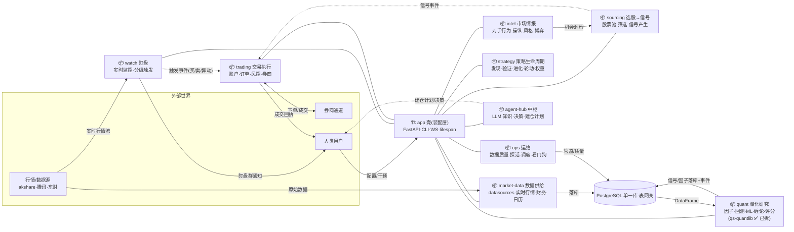
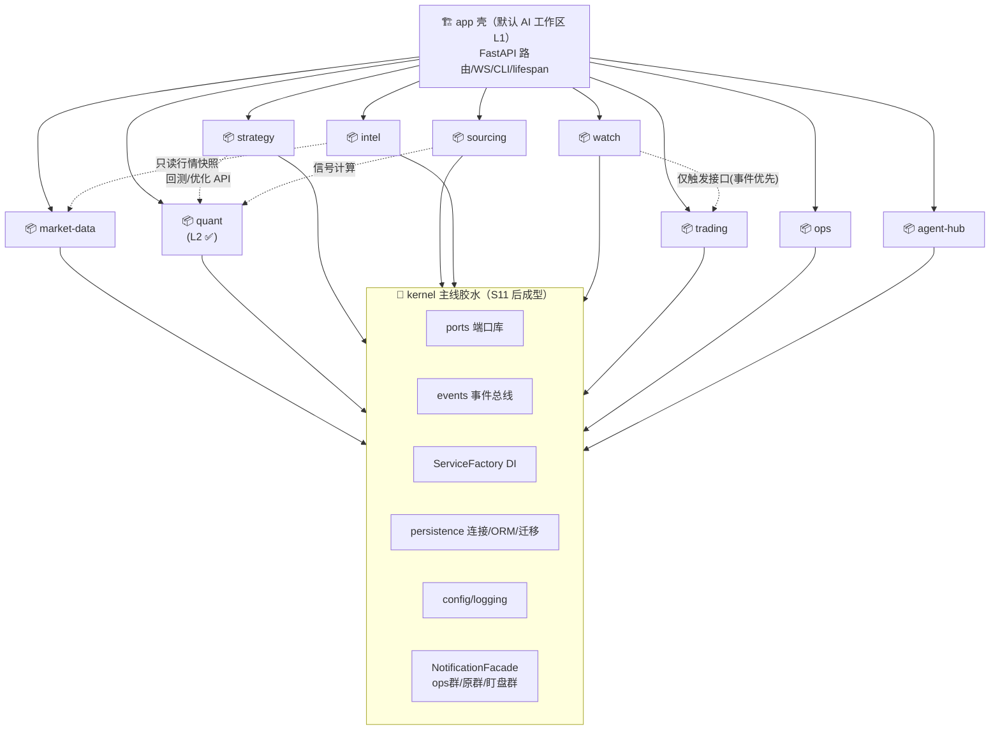

# 方案卡：包边界切分 + import 规则（scoped monorepo）

**日期**：2026-10-18
**状态**：待评审（不动代码）
**动因**：AI agent 在 39 万行单体上工作面过大，任务质量下降；目标不是微服务化，而是**把 AI 单次任务需要理解的世界从 ~39 万行缩到 3~5 万行/域**。
**前置关联**：`docs/domain-boundary-audit-2026-08.md`（08-23 层间审计，当时 FAIL）、ADR-004（调度归属，已收敛）、`docs/plans/code-quality-improvement.md`。

---

## 1. 问题定义

| 现状 | 数值（2026-10-18 实测） |
|---|---|
| Python 总行数（含测试） | ~389,700 行 |
| `application/services/` | 213 文件 / 70,714 行 |
| `adapters/outbound/` | 161 文件 / 69,783 行 |
| FastAPI 路由文件 | 82 个 |
| 单文件 TOP | strategy_code_service 2,920 / datasources/manager 2,110 / kline_repository 1,858 |
| agent 任务平均触碰面 | 跨 2~4 层（audit 08-23：application 层内部横向 import 97 处违规） |

AI 表现差的机制：每次任务都需要"在全仓扫描 → 猜该改哪里 → 加载大量无关上下文"。包化的本质是**预先把"该改哪里"的知识固化进包边界与每包文档**，让 agent 的探索半径从"全仓"缩到"一个包"。

## 2. 不做什么（负范围）

- ❌ 不拆独立 git 仓库 / 不做独立版本发布的 pip 二方包——90 天 2,320 commits 的变更速度下，跨仓 PR + 版本对齐的成本高于收益。**独立仓库是 Phase 3 的可选演进，不是本卡内容。**
- ❌ 不拆微服务（ADR 意图维持单进程常驻服务）。
- ❌ 不动胶水包（见 §3 标注）。胶水包拆出去只会让 import 更碎。

## 3. 边界盘点：谁能拆、谁必须留下

### 3.1 候选能力包（可拆）

| 包 | 文件数 | 扇入（被多少文件 import / 来自几个包） | 出向干净度 | 评价 |
|---|---|---|---|---|
| `domain/quantlib` | 75 | 51 / 11 | ✅ **0 条反向依赖**，纯计算无 IO | **P1 首选**。注意：`infrastructure/quantlib/`（9 文件）残存同一名称目录，拆包时一并裁决归属 |
| `domain/backtest` | 72 | 20 / 7 | ⚠️ 11 条反向依赖（违规大户） | **先清违规再拆** |
| `domain/factors` | 26 | 8 / 4 | ✅ | 依赖 quantlib，属同一依赖链 |
| `domain/chan` | ~ | 低 | ✅ 纯算法域 | 独立算法，适合成包 |
| `domain/chip_distribution` | ~ | 低 | ✅ 独立模型（08-11 新增） | 适合成包 |
| `domain/scoring` | 8 | ~10 处 import（此前"432"系脚本口径误报，已实测校正） | ✅ | 小而干净，可随 quantlib 一起动 |
| notification 三件套 | `application/notification`(4) + `infrastructure/notification`(9) + `domain/notification`(11) | facade 扇入 17 / 6 包 | ✅ 面板已由 `NotificationFacade` 收口 | 横切但边界清晰；CLAUDE.md 已有通知架构强制规则，落包最顺 |

### 3.2 胶水枢纽（不拆，但要在本卡中"封顶定责"）

| 枢纽 | 文件数 | 扇入 | 定责 |
|---|---|---|---|
| `adapters/outbound`（repositories + datasources） | 161 | 131 处 | 唯一持久化/外部数据出口；sync/async 双轨收敛另行开卡 |
| `application/services` | 213 | 71 处 | 用例编排层，本来就允许 import 一切下层；问题是 97 处 application 内部横向 import（08-23 audit）→ 用规则约束 |
| `infrastructure/persistence` | 59 | 123 处 | DB 连接/ORM/迁移 |
| `domain/ports` | 5 | 122 处 | 集中端口库——这就是它扇入高的原因，天然胶水 |
| `infrastructure/services`（ServiceFactory） | 3 | 50 处 | DI 唯一入口（对齐 CLAUDE.md 2026-10-02 裁定） |
| `infrastructure/config` | 15 | 31 处 | 配置读取 |

## 4. 目标结构（P1 完成后）

```
quantsys-v2/
├── packages/                    # 新增：能力包（editable install，不出独立仓库）
│   ├── quantlib/                # ← domain/quantlib famously 纯计算
│   ├── factors/                 # ← domain/factors
│   ├── backtest/                # ← domain/backtest（清违规后）
│   ├── notifications/           # ← application+infrastructure+domain notification 三件套
│   ├── chan/
│   ├── chip_distribution/
│   └── scoring/                 # ← domain/scoring（低优先级）
├── domain/                      # 收缩为业务域模型 + ports（不动）
├── application/                 # 编排层（不动）
├── adapters/                    # 不动
├── infrastructure/              # 收缩；删除已迁移的 domain/* 副本
└── pyproject.toml               # 依赖 packages/*（editable path deps）
```

**规则**：
1. 每个包一个 `pyproject.toml`，`pip install -e ./packages/<pkg>`；主 `pyproject.toml` 以 editable path 依赖它们。
2. 包对外只暴露 `__init__.py` 顶层 API（版本演进不破坏调用方的内部 import 路径——迁移期保留 `domain/quantlib` 等 shim re-export）。
3. 每个包配 `CLAUDE.md`（入口符号 / 测试命令 / 禁止事项）——这是给 agent 的"包级说明书"。

## 5. import 规则（核心交付物：import-linter 契约）

新增 `.importlinter`（或 pyproject 内嵌），四条契约：

```ini
[importlinter]
root_package = .

[importlinter:contract:layered]
name = 六边形分层（外→内单向）
type = layers
layers =
    adapters.inbound |
    adapters.outbound |
    application |
    domain
# 内层不得 import 外层：domain 不能碰 application/adapters/infrastructure

[importlinter:contract:quantlib-independence]
name = quantlib 纯计算零内剖依赖
type = forbidden
source_modules = [quantlib 的包名]
forbidden_modules =
    adapters
    application
    infrastructure
    services
    repositories

[importlinter:contract:backtest-chain]
name = 计算依赖链: quantlib ← factors ← backtest（只允许向下）
type = layers
layers =
    packages.backtest
    packages.factors
    packages.quantlib

[importlinter:contract:no-cross-hook]
name = application 子域禁止横向互 import（编排层只向下）
type = forbidden
source_modules =
    application.notification
    application.risk
    application.trading
    application.strategies
forbidden_modules =
    application.services
```

**例外烧灭计划**（contract 配 `whitelisted_modules`，每条限期）：
- `domain/backtest` 的 11 条反向依赖（audit 08-23 时 domain 层 24 违规/12 文件，本轮实测 22 处/6 子包）——P2 逐条改为注入 port。
- `application` 内部横向 import 97 处——禁止改为走 ServiceFactory 具名 getter。
- 为 `conftest.py`、`infrastructure/factories.py` 等装配文件登记**显式白名单**（允许 import 一切，保持唯一）。

## 6. 分阶段落地

| Phase | 内容 | 规模 | 验收 |
|---|---|---|---|
| **P0**（1–2 天） | ① `.importlinter` 四条契约上线（违规先白名单登记而非直接 fail）；② 全仓 violation 基线清册落 `docs/plans/package-violation-baseline.md`；③ 每个候选包写出 CLAUDE.md 草稿 | 不动生产代码 | `lint-imports` 可运行；清单列出全部现存违规及归属 |
| **P1**（1 周） | 拆首个包 `quantlib`：`packages/quantlib` + editable install + shim re-export `domain/quantlib`；裁决 `infrastructure/quantlib` 归属 | ~75 文件搬迁 + import 路径替换 | pytest 全绿；`lint-imports` quantlib 契约 0 违规；52 个 sync-repo 调用方不受影响 |
| **P2**（2 周） | 依次拆 `factors` → `backtest`（backtest 需先清 11 条反向依赖）；每拆一个,烧灭该域历史违规 | 各 26/72 文件 | 对应契约 0 违规 |
| **P3**（持续） | `notifications` / `chan` / `chip_distribution` / `scoring` | — | — |
| **P4**（再评审） | 若某包出现独立演进需要（如外部复用、独立 CI 耗时），才升独立仓库 | — | — |

**每个 commit 都必须保持 pytest 绿 + `lint-imports` 违规数不增**（可以先增不白不算，规则用 whitelisted_modules 限定）。

## 7. 验收总口径

1. `lint-imports` 退出码 0（含登记白名单）。
2. 白名单条目数**只减不增**，关联 REQ 卡逐条销项。
3. AI 工作面验收（主观→半客观）：新任务的 explore 半径应为"单包 + 个别路由文件"；抽查 3 个实际任务记录触及文件数，目标 P90 ≤ 8 文件/任务（现在 p90=52）。
4. 每包测试命令独立可跑（`pytest packages/quantlib/tests`），无需起 DB。

## 8. 风险与对策

| 风险 | 对策 |
|---|---|
| import 路径大面积替换引入老路径回归 | shim re-export + 双轨期；`grep -r` 老路径 0 命中后才删 shim |
| quantlib 内部可能有隐藏的 `from application` 小缺口 | P0 基线清册先行；迁移前先清 |
| 大表专升本 `services/*` 旧别名 import | 收敛进白名单，不到期不迁移 |
| tests 618 文件祖宗 import 惯性 | 包级测试 + 根级 conftest 分层，测试 import 也过 lint（用 type=forbidden 覆盖 tests 路径） |
| 与 ADR-004 / DI 收敛卡撞车 | 排期上把 P1 quantlib 放在 DI 迁移（34+9 文件）之后或交叉进行，双方都列"改 import 就顺手走 ServiceFactory" |

## 9. 本次分析口径备注

- 行数/扇入数据基于 `os.walk` + 首两段路径归组；排除 venv、archive、live_trading、tests、tools、docs、node_modules。
- `domain/scoring` 高扇入为早期脚本口径误报，已用 `grep` 实测校正为 ~10 处引用。
- 08-23 audit 报"domain 层 24 违规/12 文件"，本轮按"import 行"口径测得 22 处/6 子包——两个数字都能当基线，Phase 0 清册以统一口径（按 import 行）再跑一次为准。

## 10. AI 工作区分层（2026-10-18 用户裁定：AI 工作区 = 一个项目 = 该领域业务）

包化方案的消费方式固化为三层工作区约定：

| AI 工作区（cwd） | 目录 | 何时用（任务形态） | 上下文来源 |
|---|---|---|---|
| L1 根工作区 | `quantsys-v2/` | 跨层任务：加路由、排障、线上联调 | 根 CLAUDE.md + 各包索引 |
| L2 领域包工作区 | `packages/<domain>/` | 域内任务：改算法 / 加指标 / 调因子 | 仅该包 CLAUDE.md |
| L3 实验区 | 包内 `scratch/` 或 `tools/oneoff/` | 一次性脚本 | 无需 |

**支撑条件**（P1 起逐包落地）：
1. 每包 `pyproject.toml` + `tests/` + `CLAUDE.md` 三件套完整；纯计算包不起 DB 可独立跑测。
2. 兄弟包依赖用 editable path 依赖（`quantlib @ file:///../quantlib`），幂等重装脚本托底。
3. **包级 CLAUDE.md 必须自足**：L2 工作区下 agent 读不到根级文档，包文档需含入口符号、依赖链位置（如 "backtest 可 import factors/quantlib，反之禁止"）、常见任务路径。
4. **硬前提：领域必须收口在包内**。跨层任务（路由+编排+仓储）落回 L1。应用层的域（watch 盯盘 / 调度器 / 现场编排 orchestrator）**不满足**"包=项目"，维持 L1 工作区 + 探索半径约束，待其独立成 package 化后再升级 L2。

**验收补充**：P1 quantlib 迁移完成后，实际发起一次"L2 工作区内完成一个真实指标任务"作为工作区模式的验收用例。

## 11. 演进目标修订（2026-10-18 用户二次澄清：一个包 = 一个业务项目）

用户在 §10 基础上升级目标：不是"叶子算法包"，而是**业务垂直切分**——盯盘/运维/量化/交易各自成为可独立开发的"项目"，中间一条 kernel 做胶水。本节取代 §10 的分层映射，作为 P1 之后的北极星。

### 11.1 项目 ↔ 现有代码的归拢映射（2026-10-18 修订：按实测功能面聚类，用户给的 4 例是示例不是最终分区）

以 `application/services` 153 文件 + domain 子域 + infrastructure 实测聚类，**9 个业务项目 + kernel + app 壳**：

| 业务项目 | 服务文件(实测) | 吸收的 domain/infrastructure 模块 | 备注 |
|---|---|---|---|
| **market-data 数据供给** | 22 | `adapters/outbound/datasources`(manager 2110 行+providers)、股票代码校验、交易日历 | 对外唯一取数出口（CLAUDE.md 数据规则的对齐物） |
| **quant 量化研究** | 20 | `qs_quantlib`(✅已拆) + `domain/factors·backtest·benchmarks·chan·scoring` | 缠论三件套(distiller/scan/service)归此；策略优化器(search_space/ml_weight)归此 |
| **strategy 策略生命周期** | 24 | `domain/strategies` | 发现→验证→进化→轮动→权重；strategy_code_service(2920 行)瘦身在此 |
| **sourcing 选股→信号流水线** | 17 | stock_pool 仓储/股票池域 | 池管理+筛选+信号产生+信号执行调度——"机会生产"一条线（pool+signal 合并裁量点见下） |
| **intel 市场情报博弈** | 19 | `domain/competition·industry_chain` | 对手行为/操纵检测/风格/情绪/microstructure/LHB/热点图/机会评分 |
| **watch 盯盘** | 2 | `domain/watch`(15 文件)+watch_engine(908 行)+bootstrap | 小而独立；通知走 notification 包 |
| **trading 交易执行** | 14 | `domain/accounts·trading·portfolio·brokers·legacy·risk` | 含仿真/实盘、盘中止损、保护线、买入区间 |
| **ops 运维** | ~20 | data_quality、交易日守卫、熔断告警、`infrastructure/jobs·scheduler·daemon`、看门狗 | 调度 handler 装配（scheduler_tasks_*）归此 |
| **agent-hub agent 中枢** | 11 | `domain/memory` | agent-os 对接/LLM/知识/决策/会话/事件流——所有项目都可能被 agent 读写，独立成包防横切污染 |
| **kernel 主线胶水** | — | notification 三件套、`base_service`、`infrastructure/{config,logging,persistence,ports,events}`、ServiceFactory | S5 抽取，不是第一步 |
| **app 壳** | — | FastAPI 路由/WS/CLI/lifespan | 装配层=默认 L1 工作区 |

**三个裁量点（默认值已选，可推翻）**：
1. pool+signal 是否合并为 sourcing 流水线（默认合并——池扫描本就是信号源之一，拆开要建两个小包）；
2. strategy 是否并入 quant 组成"研究域"（默认分开——策略生命周期含大量业务状态机，量化研究是纯计算，工作区性质不同）；
3. agent-hub 是否并入 kernel（默认独立——它是业务逻辑不是基础设施，但若嫌包多可先并入 kernel 观察）。

**未归类 13 文件收口（2026-10-18 实测定归属）**：`stock_code_validator`→market-data；`chan_service`/`chan_scan_service`/`chan_knowledge_distiller`、`configurable_scoring_service`→quant；`strategy_performance_stats`、`strategy_code_service_factor_patch`（死补丁候选，删除裁决）→strategy；`enhanced_buy_range_service`、`analysis_services`（RiskAnalysis 简化实现）→trading；`trading_day_guard`、`circuit_breaker_alert_service`→ops；`core_plan_service`（投资脑建仓计划）→agent-hub；`base_service`→kernel。至此 153 个服务文件 **153/153 全部有归属**。


### 11.2 三条交互规则（"主线胶水"的语义）

1. **同步调用走 kernel 契约**：跨项目调用=kernel 的 ports/models 或对方包显式 public API（`__init__` 顶层）；硬 import 对方内部文件被 linter 禁止。
2. **异步耦合走事件与通知**：盯盘→交易触发、信号生成→交易执行、运维蜕变通知，统一走 `infrastructure/events` + NotificationFacade。
3. **DB 共享不拆库**：单一 PostgreSQL；各项目只拥有自己的 repositories（表网关）。跨项目读数走对方查询接口或领域事件，不直读他方表。这条规则针对的是**边界卫生**（防止跨项目隐式 import 蔓延），不是数据库事务的粗暴切断——同事务的业务仍由持有方完成。

### 11.3 分层与依赖边（修订 import-linter 目标层）

```
              ┌──────────── app 壳（可见全部项目）────────────┐
              │                                             │
  market-data  quant  strategy  sourcing  intel  watch  trading  ops  agent-hub
              │                                             │
              └─────────────────→ kernel ←──────────────────┘
```

- 依赖边白名单（→ = 允许的契约 import）：
  - **全部业务项目 → kernel**（ports/events/ServiceFactory/persistence/config/NotificationFacade）
  - `watch → trading`（仅触发接口，事件优先）——唯一保留的项目间弱依赖
  - `strategy → quant`（回测/优化器）、`sourcing → quant`（信号计算）
  - `intel → market-data`（只读行情快照）
  - `agent-hub → 各项目 public API`（agent 工具面，只经 `__init__` 顶层，不进内部文件）
- 禁止：其余业务项目之间横向硬 import（`quant ↔ trading`、`ops → 业务`、`business → watch` 等），违规经 contract 白名单登记后逐条烧灭。

### 11.4 迁移次序修订

| Step | 包 | 依赖先行 | 备注 |
|---|---|---|---|
| S1 | quant（qs-quantlib） | P0 基线 | ✅ 已完成（2026-10-18 合入 main） |
| S2 | notification 三件套先裁出（kernel 预置） | 无 | ✅ 已完成（2026-10-18，23 文件 → `packages/qs_notification`，旧路径 3 处 shim） |
| S3 | market-data | S2 | ✅ 已完成（2026-10-18，103 文件 → `packages/qs_market_data`：datasources 全目录 81 文件/16,786 行（providers 13 子包整体移动）+ 数据面服务 15 + financial/quote_providers 子包 7；旧路径 18 处 shim（datasources 根 + 15 模块 + 2 子目录）；技术债随包带来：providers 直连 akshare ×2、providers 内嵌测试树 ×1） |
| S4 | sourcing（pool+signal） | S1+S3 | ✅ 已完成（2026-10-18，25 文件 → `packages/qs_sourcing`：16 服务（pool_×6/stock_pool×2/signal×6/筛选/评分；卡记 17 与实迁 16 的差 = enhanced_buy_range_service 已在 13 文件收口改判 trading）+ 9 仓储（stock_pool/signal/signal_execution 系 sync+async 双轨 + log/test_log/tracking）；repositories/__init__ 4 处相对 import 手工改指包；旧路径 25 处 sys.modules 别名 shim；importer 双向：infrastructure DI 两层暂留 package 反向装配） |
| S5 | intel | S3 | ✅ 已完成（2026-10-18，35 文件 → `packages/qs_intel`：19 服务——对手行为/操纵检测/战场评估/博弈预警/风格·情绪·感知/环境识别/microstructure/LHB/热点图/机会评分/散户恐慌/轮动/产业链/event_feed/condition_monitor/configurable_scoring，其中 event_feed+condition_monitor+configurable_scoring 为 19 对账差额三件；+ `domain/competition·industry_chain` 两域 16 文件（ports/seed 整存）；旧路径 19 服务 sys.modules 别名 shim + 2 域 `__path__` 转发 shim；包→L1 遗留引用：部分情报仓储仍在 `adapters/outbound/repositories/`（heatmap 等），待后续归属阶段收口） |
| S6 | strategy | S1+S3+S5 | ✅ 已完成（2026-10-18，39 文件 → `packages/qs_strategy`：22 策略服务 + strategy_engine 代码引擎子包 5 文件 + domain/strategies 策略域 12 文件；strategy_code_service 瘦身凝聚力落位；排除件：scheduler_tasks_strategy 归 ops、2 个 .backup 备份垃圾留清理 pass；白名单新增边 strategy→intel（style/sentiment 只读，已登记 §11.3）；旧路径 22 alias shim + strategy_engine/domain.strategies __path__ shim） |
| S7 | trading | S1+S2+S4 | 交易类业务文件按映射表归区 |
| S8 | watch | S7 | watch_engine 的 trading 回调改走事件/端口 |
| S9 | ops | S2 | data_quality/调度装配/看门狗 |
| S10 | agent-hub | S2 | agent-os 对接/LLM/知识/决策 |
| S11 | kernel 独立成型 | 随前述推进逐步抽取 | **不是第一步**：等各项目稳定后再把公共层 extract 成独立包，避免早期过早抽象 |


## 12. 目标态架构图（业务关系 × 技术关系）

### 12.1 业务运行视图（数据怎么流）



### 12.2 技术依赖视图（代码怎么引用——import-linter 契约目标态）



**依赖规则**：实线=允许（契约 import）；虚线=弱依赖（仅事件/端口/public API）。禁止：quant↔trading、ops→业务、业务→watch 的横向硬 import；agent-hub 读业务只经各项目 `__init__` 顶层 public API，不进内部文件。

### 12.3 项目间交互矩阵（三通道语义）

| 交互 | 同步调用（port/facade） | 事件（events bus） | 数据（DB 表网关） |
|---|---|---|---|
| sourcing → trading | ❌ | ✅ `signal_generated` | ✅ sourcing 写信号表，trading 只读 |
| watch → trading | ✅ 仅触发接口 | ✅ `watch_triggered`（L2/降噪后） | ❌ |
| trading → watch | ❌ | ✅ `order_executed`（回执复核） | ❌ |
| strategy → quant / sourcing → quant | ✅ 回测/优化/信号计算 API | ❌ | ❌ |
| intel → sourcing/watch | ✅ 洞察查询 | ✅ 机会/风险事件 | ✅ 只读 |
| market-data → 任何业务 | ✅ 只读数据接口 | ❌ | 业务只写自己的表 |
| ops → 任何业务 | ❌ | ✅ 只订阅健康/失败事件 | ✅ 只读 |
| agent-hub → 任何业务 | ✅ 各项目 public API（agent 工具面） | ✅ 订阅全部事件 | 只读 |
| 任何 → kernel | ✅ ports/config/factory | — | 持久化只经 kernel 的 ORM/迁移 |
| 任何 → 通知 | ✅ NotificationFacade（分组路由） | — | — |

### 12.4 AI 工作区对照

| 业务项目 | AI 工作区 | 独立测试 | 独立 CLAUDE.md |
|---|---|---|---|
| quant | `packages/qs_quantlib/`（L2 ✅ 已可用） | ✅ 不起 DB | ✅ |
| market-data / sourcing / intel / strategy / trading / watch / ops / agent-hub | 逐包迁出后升 L2 | 迁出时建立 | 迁出时建立 |
| app 壳 / kernel | `quantsys-v2/`（L1） | 集成测试 | 根级 |
