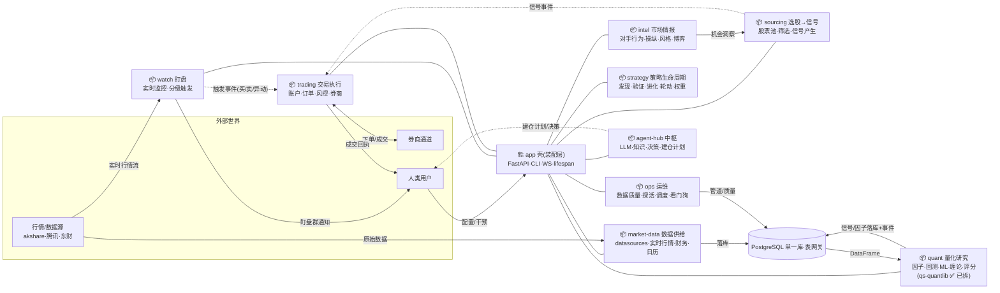
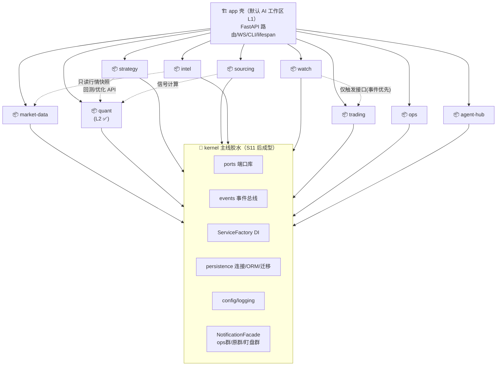

# 方案卡：包边界切分 + import 规则（scoped monorepo）

**日期**：2026-10-18
**状态**：待评审（不动代码）
**动因**：AI agent 在 39 万行单体上工作面过大，任务质量下降；目标不是微服务化，而是**把 AI 单次任务需要理解的世界从 ~39 万行缩到 3~5 万行/域**。
**前置关联**：`docs/domain-boundary-audit-2026-08.md`（08-23 层间审计，当时 FAIL）、ADR-004（调度归属，已收敛）、`docs/plans/code-quality-improvement.md`。

---

## 1. 问题定义

| 现状 | 数值（2026-10-18 实测） |
|---|---|
| Python 总行数（含测试） | ~389,700 行 |
| `application/services/` | 213 文件 / 70,714 行 |
| `adapters/outbound/` | 161 文件 / 69,783 行 |
| FastAPI 路由文件 | 82 个 |
| 单文件 TOP | strategy_code_service 2,920 / datasources/manager 2,110 / kline_repository 1,858 |
| agent 任务平均触碰面 | 跨 2~4 层（audit 08-23：application 层内部横向 import 97 处违规） |

AI 表现差的机制：每次任务都需要"在全仓扫描 → 猜该改哪里 → 加载大量无关上下文"。包化的本质是**预先把"该改哪里"的知识固化进包边界与每包文档**，让 agent 的探索半径从"全仓"缩到"一个包"。

## 2. 不做什么（负范围）

- ❌ 不拆独立 git 仓库 / 不做独立版本发布的 pip 二方包——90 天 2,320 commits 的变更速度下，跨仓 PR + 版本对齐的成本高于收益。**独立仓库是 Phase 3 的可选演进，不是本卡内容。**
- ❌ 不拆微服务（ADR 意图维持单进程常驻服务）。
- ❌ 不动胶水包（见 §3 标注）。胶水包拆出去只会让 import 更碎。

## 3. 边界盘点：谁能拆、谁必须留下

### 3.1 候选能力包（可拆）

| 包 | 文件数 | 扇入（被多少文件 import / 来自几个包） | 出向干净度 | 评价 |
|---|---|---|---|---|
| `domain/quantlib` | 75 | 51 / 11 | ✅ **0 条反向依赖**，纯计算无 IO | **P1 首选**。注意：`infrastructure/quantlib/`（9 文件）残存同一名称目录，拆包时一并裁决归属 |
| `domain/backtest` | 72 | 20 / 7 | ⚠️ 11 条反向依赖（违规大户） | **先清违规再拆** |
| `domain/factors` | 26 | 8 / 4 | ✅ | 依赖 quantlib，属同一依赖链 |
| `domain/chan` | ~ | 低 | ✅ 纯算法域 | 独立算法，适合成包 |
| `domain/chip_distribution` | ~ | 低 | ✅ 独立模型（08-11 新增） | 适合成包 |
| `domain/scoring` | 8 | ~10 处 import（此前"432"系脚本口径误报，已实测校正） | ✅ | 小而干净，可随 quantlib 一起动 |
| notification 三件套 | `application/notification`(4) + `infrastructure/notification`(9) + `domain/notification`(11) | facade 扇入 17 / 6 包 | ✅ 面板已由 `NotificationFacade` 收口 | 横切但边界清晰；CLAUDE.md 已有通知架构强制规则，落包最顺 |

### 3.2 胶水枢纽（不拆，但要在本卡中"封顶定责"）

| 枢纽 | 文件数 | 扇入 | 定责 |
|---|---|---|---|
| `adapters/outbound`（repositories + datasources） | 161 | 131 处 | 唯一持久化/外部数据出口；sync/async 双轨收敛另行开卡 |
| `application/services` | 213 | 71 处 | 用例编排层，本来就允许 import 一切下层；问题是 97 处 application 内部横向 import（08-23 audit）→ 用规则约束 |
| `infrastructure/persistence` | 59 | 123 处 | DB 连接/ORM/迁移 |
| `domain/ports` | 5 | 122 处 | 集中端口库——这就是它扇入高的原因，天然胶水 |
| `infrastructure/services`（ServiceFactory） | 3 | 50 处 | DI 唯一入口（对齐 CLAUDE.md 2026-10-02 裁定） |
| `infrastructure/config` | 15 | 31 处 | 配置读取 |

## 4. 目标结构（P1 完成后）

```
quantsys-v2/
├── packages/                    # 新增：能力包（editable install，不出独立仓库）
│   ├── quantlib/                # ← domain/quantlib famously 纯计算
│   ├── factors/                 # ← domain/factors
│   ├── backtest/                # ← domain/backtest（清违规后）
│   ├── notifications/           # ← application+infrastructure+domain notification 三件套
│   ├── chan/
│   ├── chip_distribution/
│   └── scoring/                 # ← domain/scoring（低优先级）
├── domain/                      # 收缩为业务域模型 + ports（不动）
├── application/                 # 编排层（不动）
├── adapters/                    # 不动
├── infrastructure/              # 收缩；删除已迁移的 domain/* 副本
└── pyproject.toml               # 依赖 packages/*（editable path deps）
```

**规则**：
1. 每个包一个 `pyproject.toml`，`pip install -e ./packages/<pkg>`；主 `pyproject.toml` 以 editable path 依赖它们。
2. 包对外只暴露 `__init__.py` 顶层 API（版本演进不破坏调用方的内部 import 路径——迁移期保留 `domain/quantlib` 等 shim re-export）。
3. 每个包配 `CLAUDE.md`（入口符号 / 测试命令 / 禁止事项）——这是给 agent 的"包级说明书"。

## 5. import 规则（核心交付物：import-linter 契约）

新增 `.importlinter`（或 pyproject 内嵌），四条契约：

```ini
[importlinter]
root_package = .

[importlinter:contract:layered]
name = 六边形分层（外→内单向）
type = layers
layers =
    adapters.inbound |
    adapters.outbound |
    application |
    domain
# 内层不得 import 外层：domain 不能碰 application/adapters/infrastructure

[importlinter:contract:quantlib-independence]
name = quantlib 纯计算零内剖依赖
type = forbidden
source_modules = [quantlib 的包名]
forbidden_modules =
    adapters
    application
    infrastructure
    services
    repositories

[importlinter:contract:backtest-chain]
name = 计算依赖链: quantlib ← factors ← backtest（只允许向下）
type = layers
layers =
    packages.backtest
    packages.factors
    packages.quantlib

[importlinter:contract:no-cross-hook]
name = application 子域禁止横向互 import（编排层只向下）
type = forbidden
source_modules =
    application.notification
    application.risk
    application.trading
    application.strategies
forbidden_modules =
    application.services
```

**例外烧灭计划**（contract 配 `whitelisted_modules`，每条限期）：
- `domain/backtest` 的 11 条反向依赖（audit 08-23 时 domain 层 24 违规/12 文件，本轮实测 22 处/6 子包）——P2 逐条改为注入 port。
- `application` 内部横向 import 97 处——禁止改为走 ServiceFactory 具名 getter。
- 为 `conftest.py`、`infrastructure/factories.py` 等装配文件登记**显式白名单**（允许 import 一切，保持唯一）。

## 6. 分阶段落地

| Phase | 内容 | 规模 | 验收 |
|---|---|---|---|
| **P0**（1–2 天） | ① `.importlinter` 四条契约上线（违规先白名单登记而非直接 fail）；② 全仓 violation 基线清册落 `docs/plans/package-violation-baseline.md`；③ 每个候选包写出 CLAUDE.md 草稿 | 不动生产代码 | `lint-imports` 可运行；清单列出全部现存违规及归属 |
| **P1**（1 周） | 拆首个包 `quantlib`：`packages/quantlib` + editable install + shim re-export `domain/quantlib`；裁决 `infrastructure/quantlib` 归属 | ~75 文件搬迁 + import 路径替换 | pytest 全绿；`lint-imports` quantlib 契约 0 违规；52 个 sync-repo 调用方不受影响 |
| **P2**（2 周） | 依次拆 `factors` → `backtest`（backtest 需先清 11 条反向依赖）；每拆一个,烧灭该域历史违规 | 各 26/72 文件 | 对应契约 0 违规 |
| **P3**（持续） | `notifications` / `chan` / `chip_distribution` / `scoring` | — | — |
| **P4**（再评审） | 若某包出现独立演进需要（如外部复用、独立 CI 耗时），才升独立仓库 | — | — |

**每个 commit 都必须保持 pytest 绿 + `lint-imports` 违规数不增**（可以先增不白不算，规则用 whitelisted_modules 限定）。

## 7. 验收总口径

1. `lint-imports` 退出码 0（含登记白名单）。
2. 白名单条目数**只减不增**，关联 REQ 卡逐条销项。
3. AI 工作面验收（主观→半客观）：新任务的 explore 半径应为"单包 + 个别路由文件"；抽查 3 个实际任务记录触及文件数，目标 P90 ≤ 8 文件/任务（现在 p90=52）。
4. 每包测试命令独立可跑（`pytest packages/quantlib/tests`），无需起 DB。

## 8. 风险与对策

| 风险 | 对策 |
|---|---|
| import 路径大面积替换引入老路径回归 | shim re-export + 双轨期；`grep -r` 老路径 0 命中后才删 shim |
| quantlib 内部可能有隐藏的 `from application` 小缺口 | P0 基线清册先行；迁移前先清 |
| 大表专升本 `services/*` 旧别名 import | 收敛进白名单，不到期不迁移 |
| tests 618 文件祖宗 import 惯性 | 包级测试 + 根级 conftest 分层，测试 import 也过 lint（用 type=forbidden 覆盖 tests 路径） |
| 与 ADR-004 / DI 收敛卡撞车 | 排期上把 P1 quantlib 放在 DI 迁移（34+9 文件）之后或交叉进行，双方都列"改 import 就顺手走 ServiceFactory" |

## 9. 本次分析口径备注

- 行数/扇入数据基于 `os.walk` + 首两段路径归组；排除 venv、archive、live_trading、tests、tools、docs、node_modules。
- `domain/scoring` 高扇入为早期脚本口径误报，已用 `grep` 实测校正为 ~10 处引用。
- 08-23 audit 报"domain 层 24 违规/12 文件"，本轮按"import 行"口径测得 22 处/6 子包——两个数字都能当基线，Phase 0 清册以统一口径（按 import 行）再跑一次为准。

## 10. AI 工作区分层（2026-10-18 用户裁定：AI 工作区 = 一个项目 = 该领域业务）

包化方案的消费方式固化为三层工作区约定：

| AI 工作区（cwd） | 目录 | 何时用（任务形态） | 上下文来源 |
|---|---|---|---|
| L1 根工作区 | `quantsys-v2/` | 跨层任务：加路由、排障、线上联调 | 根 CLAUDE.md + 各包索引 |
| L2 领域包工作区 | `packages/<domain>/` | 域内任务：改算法 / 加指标 / 调因子 | 仅该包 CLAUDE.md |
| L3 实验区 | 包内 `scratch/` 或 `tools/oneoff/` | 一次性脚本 | 无需 |

**支撑条件**（P1 起逐包落地）：
1. 每包 `pyproject.toml` + `tests/` + `CLAUDE.md` 三件套完整；纯计算包不起 DB 可独立跑测。
2. 兄弟包依赖用 editable path 依赖（`quantlib @ file:///../quantlib`），幂等重装脚本托底。
3. **包级 CLAUDE.md 必须自足**：L2 工作区下 agent 读不到根级文档，包文档需含入口符号、依赖链位置（如 "backtest 可 import factors/quantlib，反之禁止"）、常见任务路径。
4. **硬前提：领域必须收口在包内**。跨层任务（路由+编排+仓储）落回 L1。应用层的域（watch 盯盘 / 调度器 / 现场编排 orchestrator）**不满足**"包=项目"，维持 L1 工作区 + 探索半径约束，待其独立成 package 化后再升级 L2。

**验收补充**：P1 quantlib 迁移完成后，实际发起一次"L2 工作区内完成一个真实指标任务"作为工作区模式的验收用例。

## 11. 演进目标修订（2026-10-18 用户二次澄清：一个包 = 一个业务项目）

用户在 §10 基础上升级目标：不是"叶子算法包"，而是**业务垂直切分**——盯盘/运维/量化/交易各自成为可独立开发的"项目"，中间一条 kernel 做胶水。本节取代 §10 的分层映射，作为 P1 之后的北极星。

### 11.1 项目 ↔ 现有代码的归拢映射（2026-10-18 修订：按实测功能面聚类，用户给的 4 例是示例不是最终分区）

以 `application/services` 153 文件 + domain 子域 + infrastructure 实测聚类，**9 个业务项目 + kernel + app 壳**：

| 业务项目 | 服务文件(实测) | 吸收的 domain/infrastructure 模块 | 备注 |
|---|---|---|---|
| **market-data 数据供给** | 22 | `adapters/outbound/datasources`(manager 2110 行+providers)、股票代码校验、交易日历 | 对外唯一取数出口（CLAUDE.md 数据规则的对齐物） |
| **quant 量化研究** | 20 | `qs_quantlib`(✅已拆) + `domain/factors·backtest·benchmarks·chan·scoring` | 缠论三件套(distiller/scan/service)归此；策略优化器(search_space/ml_weight)归此 |
| **strategy 策略生命周期** | 24 | `domain/strategies` | 发现→验证→进化→轮动→权重；strategy_code_service(2920 行)瘦身在此 |
| **sourcing 选股→信号流水线** | 17 | stock_pool 仓储/股票池域 | 池管理+筛选+信号产生+信号执行调度——"机会生产"一条线（pool+signal 合并裁量点见下） |
| **intel 市场情报博弈** | 19 | `domain/competition·industry_chain` | 对手行为/操纵检测/风格/情绪/microstructure/LHB/热点图/机会评分 |
| **watch 盯盘** | 2 | `domain/watch`(15 文件)+watch_engine(908 行)+bootstrap | 小而独立；通知走 notification 包 |
| **trading 交易执行** | 14 | `domain/accounts·trading·portfolio·brokers·legacy·risk` | 含仿真/实盘、盘中止损、保护线、买入区间 |
| **ops 运维** | ~20 | data_quality、交易日守卫、熔断告警、`infrastructure/jobs·scheduler·daemon`、看门狗 | 调度 handler 装配（scheduler_tasks_*）归此 |
| **agent-hub agent 中枢** | 11 | `domain/memory` | agent-os 对接/LLM/知识/决策/会话/事件流——所有项目都可能被 agent 读写，独立成包防横切污染 |
| **kernel 主线胶水** | — | notification 三件套、`base_service`、`infrastructure/{config,logging,persistence,ports,events}`、ServiceFactory | S5 抽取，不是第一步 |
| **app 壳** | — | FastAPI 路由/WS/CLI/lifespan | 装配层=默认 L1 工作区 |

**三个裁量点（默认值已选，可推翻）**：
1. pool+signal 是否合并为 sourcing 流水线（默认合并——池扫描本就是信号源之一，拆开要建两个小包）；
2. strategy 是否并入 quant 组成"研究域"（默认分开——策略生命周期含大量业务状态机，量化研究是纯计算，工作区性质不同）；
3. agent-hub 是否并入 kernel（默认独立——它是业务逻辑不是基础设施，但若嫌包多可先并入 kernel 观察）。

**未归类 13 文件收口（2026-10-18 实测定归属）**：`stock_code_validator`→market-data；`chan_service`/`chan_scan_service`/`chan_knowledge_distiller`、`configurable_scoring_service`→quant；`strategy_performance_stats`、`strategy_code_service_factor_patch`（死补丁候选，删除裁决）→strategy；`enhanced_buy_range_service`、`analysis_services`（RiskAnalysis 简化实现）→trading；`trading_day_guard`、`circuit_breaker_alert_service`→ops；`core_plan_service`（投资脑建仓计划）→agent-hub；`base_service`→kernel。至此 153 个服务文件 **153/153 全部有归属**。


### 11.2 三条交互规则（"主线胶水"的语义）

1. **同步调用走 kernel 契约**：跨项目调用=kernel 的 ports/models 或对方包显式 public API（`__init__` 顶层）；硬 import 对方内部文件被 linter 禁止。
2. **异步耦合走事件与通知**：盯盘→交易触发、信号生成→交易执行、运维蜕变通知，统一走 `infrastructure/events` + NotificationFacade。
3. **DB 共享不拆库**：单一 PostgreSQL；各项目只拥有自己的 repositories（表网关）。跨项目读数走对方查询接口或领域事件，不直读他方表。这条规则针对的是**边界卫生**（防止跨项目隐式 import 蔓延），不是数据库事务的粗暴切断——同事务的业务仍由持有方完成。

### 11.3 分层与依赖边（修订 import-linter 目标层）

```
              ┌──────────── app 壳（可见全部项目）────────────┐
              │                                             │
  market-data  quant  strategy  sourcing  intel  watch  trading  ops  agent-hub
              │                                             │
              └─────────────────→ kernel ←──────────────────┘
```

- 依赖边白名单（→ = 允许的契约 import）：
  - **全部业务项目 → kernel**（ports/events/ServiceFactory/persistence/config/NotificationFacade）
  - `watch → trading`（仅触发接口，事件优先）——唯一保留的项目间弱依赖
  - `strategy → quant`（回测/优化器）、`sourcing → quant`（信号计算）
  - `intel → market-data`（只读行情快照）
  - `agent-hub → 各项目 public API`（agent 工具面，只经 `__init__` 顶层，不进内部文件）
- 禁止：其余业务项目之间横向硬 import（`quant ↔ trading`、`ops → 业务`、`business → watch` 等），违规经 contract 白名单登记后逐条烧灭。

### 11.4 迁移次序修订

| Step | 包 | 依赖先行 | 备注 |
|---|---|---|---|
| S1 | quant（qs-quantlib） | P0 基线 | ✅ 已完成（2026-10-18 合入 main） |
| S2 | notification 三件套先裁出（kernel 预置） | 无 | ✅ 已完成（2026-10-18，23 文件 → `packages/qs_notification`，旧路径 3 处 shim） |
| S3 | market-data | S2 | ✅ 已完成（2026-10-18，103 文件 → `packages/qs_market_data`：datasources 全目录 81 文件/16,786 行（providers 13 子包整体移动）+ 数据面服务 15 + financial/quote_providers 子包 7；旧路径 18 处 shim（datasources 根 + 15 模块 + 2 子目录）；技术债随包带来：providers 直连 akshare ×2、providers 内嵌测试树 ×1；反向件收尾：L1 侧 `infrastructure.quantlib.adapters` 向后兼容 shim 移除（2026-10-19，`chore/prune-quantlib-adapter-shim`——自述 remove-after 2026-09-19 过期一月；消费 7 站全量改线 canonical `adapters.outbound.datasources.providers.quantlib.factor_calculator_adapter`，`infrastructure/quantlib/__init__` 结构文档同步；shim 的 deprecation 告警随之消失（hub 批 warnings 3→2）；当卡 9 定向测试 8F 与主路径基线逐条同 ID 同错=预存 DB/数据依赖与本卡无关，26 成员集 0F/185P/2S） |
| S4 | sourcing（pool+signal） | S1+S3 | ✅ 已完成（2026-10-18，25 文件 → `packages/qs_sourcing`：16 服务（pool_×6/stock_pool×2/signal×6/筛选/评分；卡记 17 与实迁 16 的差 = enhanced_buy_range_service 已在 13 文件收口改判 trading）+ 9 仓储（stock_pool/signal/signal_execution 系 sync+async 双轨 + log/test_log/tracking）；repositories/__init__ 4 处相对 import 手工改指包；旧路径 25 处 sys.modules 别名 shim；importer 双向：infrastructure DI 两层暂留 package 反向装配） |
| S5 | intel | S3 | ✅ 已完成（2026-10-18，35 文件 → `packages/qs_intel`：19 服务——对手行为/操纵检测/战场评估/博弈预警/风格·情绪·感知/环境识别/microstructure/LHB/热点图/机会评分/散户恐慌/轮动/产业链/event_feed/condition_monitor/configurable_scoring，其中 event_feed+condition_monitor+configurable_scoring 为 19 对账差额三件；+ `domain/competition·industry_chain` 两域 16 文件（ports/seed 整存）；旧路径 19 服务 sys.modules 别名 shim + 2 域 `__path__` 转发 shim；包→L1 遗留引用：部分情报仓储仍在 `adapters/outbound/repositories/`（heatmap 等），待后续归属阶段收口） |
| S6 | strategy | S1+S3+S5 | ✅ 已完成（2026-10-18，39 文件 → `packages/qs_strategy`：22 策略服务 + strategy_engine 代码引擎子包 5 文件 + domain/strategies 策略域 12 文件；strategy_code_service 瘦身凝聚力落位；排除件：scheduler_tasks_strategy 归 ops、2 个 .backup 备份垃圾留清理 pass；白名单新增边 strategy→intel（style/sentiment 只读，已登记 §11.3）；旧路径 22 alias shim + strategy_engine/domain.strategies __path__ shim） |
| S7 | trading | S1+S2+S6 | ✅ 已完成（2026-10-18，79 文件 → `packages/qs_trading`：14 服务——account_trading/trade/execution/position/intraday_monitor(止损止盈)/portfolio_breaker(保护线)/enhanced_buy_range(买入区间收口件)/portfolio_optimization/simulation/enhanced_risk_assessor/risk/risk_check/risk_metrics/market_session + `domain` 六域整目录 65 文件（accounts/trading/portfolio/brokers/legacy/risk，含 ports 子包，域内端口裁决条款随目录原样落位）；根因修版：pip 依赖名用 `empyrical-reloaded`（venv 供模块化的发行名，原生 empyrical 构建 wheel 失败）；qs_quantlib `__init__` docstring 里 1 处 domain.risk 示例非执行面保持原样；残留混装 `core_async_services.py` 已拆分（2026-10-19，`split/core-async-services`：L1 同名录包化 `application/services/core_async_services/{data,market_data,performance}.py`，import 面不变， 驱出死类 3 删除——其内部 IStockRepository/IRiskRepository(session) 等端口 ABC 实例化即炸模式已随删除消除 3/4。ABC 必炸残留 3 路径也已收尾（2026-10-19 小卡 `fix/core-async-abc`：三处换 `StockAsyncRepository` 并实调出数据——get_stock_info(600519.SH)=贵州茅台/get_active_stocks=1000 行/search_stocks(平安)=3 行；`get_stock_info` 顺带去后缀归一，因 `Stock` 主键 `symbol` 存裸代码，`'600519.SH'` 主键直查必落空）；白名单新增边 trading→strategy（simulation 回放 domain/strategies，已登记）；旧路径 14 alias shim + 六域 __path__ shim（真实包 risk/__init__ 本就 `__all__=[]`，shim 忠实复刻） |
| S8 | watch | S7 | ✅ 已完成（2026-10-18，41 文件 → `packages/qs_watch`：watch_engine 引擎子包 25 文件（engine/conditions/rule_evaluator/trigger_judge/dedup/notifier/receipt/todo/digest/disposition/escalation/noise_self_heal/observe_aggregator/position_lifecycle/shadow_mode_clock/intervention_ledger/market_watch/meta_review/guidance_backfill/notifier/watch_channels/watch_loop_wiring/factory/dto）+ opportunity_to_watch_rule_service（机会转规则）+ `domain/watch` 盯盘域 15 文件（models/ports + services 子包 12）；deps requests+structlog；跨包边 qs_market_data（quote tick）+ qs_notification（分级通知三件套）+ qs_trading（trading 回调，白名单既定边）；`watch_bootstrap` **留在 app 壳** `adapters/inbound/fastapi_app/watch_bootstrap.py` 不迁（方案卡装配层=L1 原则，宿主契约测试守护）；旧路径 3 shim：watch_engine `__path__`、opportunity sys.modules 别名、domain/watch `__path__`；member 测试 55 文件 1F/747P 真实失败集与基线逐字节一致（0 回归），收集 6504/0 |
| S9 | ops | S2 | ✅ 已完成（2026-10-18，36 文件 → `packages/qs_ops`：scheduler_tasks 任务域 12（registry/common/data/factors/models/reports/runtime/signals/strategy/training_guard + 主入口）+ `infrastructure/scheduler` 7（apscheduler_service/scheduler 悬置态留库/cron_compat/job_executor/scheduled_tasks/task_fields/signal_execution_job）+ `infrastructure/jobs` 14 py（kline/chip_distribution/financial 三件/fund_flow/index_constituents/data_quality_check/market_style/risk_check/strategy_risk_check/strategy_trading/verification/weekly_report/monitor_jobs）+ trading_day_guard/data_quality_service；deps APScheduler+structlog；**顶点装配者**——允许依赖全部业务包，业务包反向依赖违规；新边 ops→live_trading（simulation_trader 仿真）登记；`daily_jobs_bootstrap`/`watch_sla_job` 留 app 壳；member 测试 47 文件 6F/469P/5S 真实失败集与基线逐字节一致（0 回归），收集 6504/0；⚠️ 新坑实记：BSD sed `[[:<:]]` 点号后仍算词边界，二遍 sed 会双前缀（qs_ops.qs_ops×69，已全局收敛归零）——**同一文件集不得跑两遍成员名 sed**，补漏需用排除已前缀串的窄模式 |
| S10 | agent-hub | S2 | ✅ 已完成（2026-10-19，17 文件 → `packages/qs_agenthub`：agent-os 对接 4（agent_os_client/agent_scheduler_tool/agent_notification_service/scheduler_handlers）+ LLM/知识/决策 5（llm_service/knowledge_service/chan_knowledge_distiller/decision_service/decision_evaluator）+ evolution 子包 8（daily_snapshot/decision_score/evolution_fitness/fitness_calculator/lesson_generator/missed_opportunity/score_calculator）；deps httpx+requests；**边界裁决**：`api/internal/scheduler_webhook.py`（Agent OS webhook 收件器，main.py 已接入）**留 app 壳**，hub handlers 经它共享 JOB_HANDLERS 注册表（hub→api.internal 方向异常已登记，项目化时收口）；`application/jobs/`（JobRegistry 调度协议层）**已归并 qs_ops**（2026-10-19，`merge/app-jobs-into-ops`：12 文件搬入 `qs_ops.application.jobs`，12 个消费文件全量改线不留 shim——job_registry 为模块级单例，`__path__` 转发会产双模块身份破坏单例，故删除旧目录；worktree 验证前须在 worktree 侧重装 qs_ops 映射，合并后回主路径重装；**白名单新增边 ×3**：agenthub/intel/strategy→qs_ops.application.jobs（leaf 协议 import：Job/JobResult/result_from_dict/job_registry 分发面，协议类型依赖非编排依赖，按 S7 trading→strategy 同款先例登记））；`session_service.py` 已归并 qs_agenthub（2026-10-19，`feat/session-service-hub`：git mv 至 hub 平级目录，4 处接线全量改线不留 shim——无模块级单例、消费面仅 factory+3 测试；同卡 3 定向测试 14P1F 单 F 与主路径基线同 ID=parity ai_diagnosis 503 LLM unavailable(test) 环境性预存、不在 26 批，26 成员集 0F/185P/2S）；**预存缺陷登记**：session_service.ingest_events 连接不关→test_ai_diagnosis 挂死（AccessShare 堵 AccessExclusive，实测 pg_locks 取证），member 测试 25 文件 1F/180P/2S 与基线逐字节一致（0 回归），收集 6504/0；**挂死缺陷已修**（2026-10-19，`fix/session-service-conn-leak`）：pytest 线程无 teardown，fixture 补 `close_session()`（test_ai_diagnosis/test_session_service），26 成员集含 ai_diagnosis 重跑 1F/184P/2S——单 F 与基线同 ID（evolution_pipeline 预存），4 用例挂起复活，该 1F 亦已修复（自给自足断言 + fixture cleanup 补 commit），成员集 0F/185P/2S |
| S11 | kernel 独立成型 | 随前述推进逐步抽取 | **Slice A 已完成**（2026-10-19，`packages/qs_kernel`，取证见 §13 S11-A 段）：kernel 胶水层 27 文件 git mv（`infrastructure/{config(含 constants 子树),logging,events}`、`domain/{ports,events,models,common}`、`application/services/base_service`）+ 包骨架 + 全仓 ~230 文件 import 重接；ServiceFactory/enhanced_service_factory/service_registry 业务装配**留 L1**（"kernel-DI vs 业务装配双层"决策点的 Slice A 口径：只搬公共件）；L1 旧路径 7 shim（星号转发 + `__path__` 追加，30 天观察期同前例）；ConfigLoader `_find_config_dir_upward` 可移植性修复；validator 报告改 stdout + 顺修预存裸 `logger.info()` 崩溃；qs_kernel editable 锚主路径；launchctl 重启 health 200；26 成员集 185P/2S/0F 基线命中 |
| S11-B | kernel 余量（persistence/engine、ServiceFactory 双层拆分、反向越层两例收口） | S11-A | **Slice B-1 已完成待合并**（2026-10-19，worktree kernel-b `feat/kernel-glue-b` 1a0607c77，取证见 §13 S11-B-1 段）：12 文件 git mv 入 `packages/qs_kernel`（`infrastructure/persistence/orm` 7 + `database` 5）+ L1 双 shim + ~200 文件 import 重接；ServiceFactory 双层拆分与反向越层两例仍待用户定夺后另行开卡 |


## 12. 目标态架构图（业务关系 × 技术关系）

## 13. 残留登记台账（2026-10-19 起：S1-S10 + 增量卡完结后的等待态统一载体）

此前部分残留只记录在会话上下文中，本节将其固化，按状态分列：

| 项 | 状态 | 依据/锚点 | 处置口径 |
|---|---|---|---|
| L1 转发 shim 30 天观察期（2026-10-18 各包落地起算） | 等待 | 本卡各 S 行 shim 句 | 2026-11 中旬收割：reflog 确认无回退引用后逐包删 shim |
| S11 kernel 独立成型 | **Slice A 已合（2026-10-19，31be3d0a0）/ 余量转 S11-B** | §11.4 S11 行 + §13 S11-A 段 | S11-B 待用户定夺 |
| 5 存疑账户终裁（不动） | 结案 | 既裁登记 | 不处置 |
| hub→qd_agenthub 对 api.internal 方向异常 | 缓议 | session_service 归并卡登记 | qs_agenthub project 化时收口 |
| watch_triggers 处置列宽度（原登记误写为 condition） | **结案（2026-10-19，fix/watch-disposition-by-width）** | 取证见下 | disposition_by 已加宽 50→120 |
| event_bus "线程泄漏" | **判否结案（2026-10-19）** | 取证见下 | 不改码 |
| qs_quantlib docstring 内 domain.risk 旧路径示例 | 已登记 | S7 行 | 非执行面，随包维护顺带 |
| 调度能力缺口 3 项（DataPipelineService 接线定标的 / signal_monitor_realtime 无实现 / 周度风险无实现） | 等用户定夺 | ADR-004 卡 | 不当"已修复" |

**event_bus 判否取证**（2026-10-19）：① `EventBus()` 全仓实例化仅 `tests/test_event_bus.py` 8 处 + 模块级单例 1 处，生产无多实例路径；② `shutdown()` 零调用属 daemon 设计（线程随进程存亡，非累积）；③ 生产进程（PID 21298）总量 12 线程（APScheduler/DailyJobs/watch 全家兼容），结构上 event_bus 只可能占 1 个 worker，无法无界增长；④ events 包其余文件（progress_emitter/handlers）零线程引用。"泄漏"机制只存在于代码形状（构造即起线程），无生产可见缺陷。可选加固点（不作为缺陷修复）：worker 惰性启动（首次订阅/发布才起线程）、lifespan 显式调 shutdown()——记入观察项，需时另开卡。

**watch_triggers 定谳取证**（2026-10-19）：① `watch_triggers.condition` 是 JSONB 无宽度问题——原登记张冠李戴：真实 varchar(50) 是 `disposition_by`（处置主体，审计归因字段）。② 【复证修正 2026-10-19】顶格 50 字符并非截断，而是**完整 ID 的天然长度**：库内全谱（DISTINCT disposition_by）存在规整三段式 `investor-session-<8hex>-<24hex>`（17+8+1+24=50；24hex 为 ObjectId 标准长度），且同一会话 f0101ceb 同时有完整长形与短形 `investor-session-<8hex>`（25 字符）两种自发形态、其余会话（3379bf00 / agent_brain 04dec682 / agent-dh ddd16044）均以**短形完整**落库——15 次重复同一 ID=单会话稳定复用；PG 对超宽 varchar 报错而非静默截断（发来的值必然 ≤50），故从未发生裁剪。③ 【复证修正】原"调用方为适配 50 宽度先自裁"假设撤销：无自裁证据；真残留是**调用方形态不统一**（短形丢 24hex 尾码=归因粒度不一致，且 `agent:agent-ts`/`agent:w-c8cae280`/`investor(w-f0101ceb)` 等多形态并存）——v2 侧无动作，观察项。④ 修复保留（定谳复证后**降级为预防性加固**）：现格式恰好顶格，任何格式延长都会在 PG 报错，加宽无害且已合并（ORM `disposition_by String(50)→String(120)` + 迁移 `20261019_watch_triggers_disposition_by_widen`，实测列现 120、历史行原样；commit d20d96053/9ac60cb0d 的"截断实锤"表述由本复证修正取代）。⑤ 原"跨项目防御性截断"残留撤销；替代观察项：agent 侧统一以完整长形 ID 发 disposition_by（跨项目非 v2 范围）。

**测试批环境口径（2026-10-19 合并回归日实证）**：跑 DB 依赖测试批必须**剔除 DSN 变量**——`set -a; source .env; set +a; unset QUANT_DATABASE_URL DATABASE_URL POSTGRES_DSN && export PGDATABASE=quant_test && PYTHONPATH=. pytest ...`。根因：DSN 解析链 QUANT_DATABASE_URL/DATABASE_URL/POSTGRES_DSN 优先级高于 PGDATABASE（`infrastructure/persistence/database/engine.py:43-72`），source .env 导出的生产 DSN 会在 pytest 安全闸（engine.py:92）把整个 DB 批拦爆——当日实证 26 批首跑 2F/6E 全部同根（非代码回退），干净配方复跑 **185P/0F/2S 持平基线**（覆盖当日 5 合并：core_async 拆分 / ABC 修复 / session_service 归并 / quantlib shim 移除 / 处置列加宽）。附带观察项：`base_repository.py:114` `Query.get()` 的 SQLAlchemy 2.0 LegacyAPIWarning（watch e2e +2 warnings 来源，前存既定，随 2.0 现代化统一清理）。

**S11 立项预研（2026-10-19，只读普查不改码）**：10 包→L1 全谱 543 弦（按包：qs_ops=167、qs_market_data=92、qs_strategy=92 最重，编排属性所致；qs_quantlib/qs_notification 近净，仅 3/5 弦）。多包共同依赖（kernel 候选，按扇入）：① `domain/ports` 集中端口库——7 包 69 弦；② `infrastructure/services/service_factory`（DI 唯一入口）——7 包 62 弦；③ `infrastructure/persistence/orm`（models/base/config/async 双轨）+ `database/engine`——约 6 包；④ `application/services/agent_notification_service`——5 包；⑤ 共享域原语 `domain/models/market_data`、`domain/common/dates`、`domain/events.model`。单一向边最重的存量簇是 `adapters/outbound/repositories`（仅 kline_repository 即 5 包 22 弦，全簇 8 包）。立项必答的架构决策点：ServiceFactory 的业务注册表（enhanced_service_factory/service_registry 中的应用服务接线）kernel 不能携带，须拆"kernel-DI（端口+通用件）"与"业务装配留 L1"双层。反向越层待收两例：qs_watch→`adapters.inbound.fastapi_app.watch_sla_job`、qs_ops→`adapters.inbound.fastapi_app.daily_jobs_bootstrap`（包引内部适配器首例实锤）。工作量口径：约 50 文件搬迁 + 10 包 ~540 弦改线，体量相当于一张大 S 卡。

**S11-A 实施台账（2026-10-19，worktree kernel-a feat/kernel-glue-a cd73e3376 → no-ff merge 31be3d0a0）**：
- **范围**：27 文件 git mv 入 `packages/qs_kernel`（config 13 含 constants 子树 / logging / events / domain.ports 4 / domain.events 4 / domain.models / domain.common / application.services.base_service）+ 包骨架 + 全仓 ~230 文件 import 重接；271 files changed(+895/−1005)。ServiceFactory 三层与业务装配留 L1。
- **loader 修复**：`ConfigLoader._find_config_dir_upward(current_file)`——沿父目录链找最近含 `config/services.yaml` 的祖先，兜底旧三级推导；解决 worktree/包环境下 config_dir 误指主路径（单测验证 9 services parsed ✓）。
- **validator 修复**：`validate_and_report` 由 stdlib logging 改 `print()`（CLI 报告函数语义，测试锚定 stdout 的 ✅/❌/passed/failed）；顺修预存 bug——HEAD 版即存在的裸 `logger.info()`（TypeError，只在失败分支触发）。HEAD 版即 stdlib logging，该两个测试预存红。
- **预存失败登记（1F，不改）**：`tests/infrastructure/config/test_config_integration.py::test_config_field_merging`——`get_service('watch_engine') is None`。三重证据定性预存：① HEAD 与 worktree `config/services.yaml` 非 interface 行 diff 为零；② `watch_engine` 在 HEAD 顶层 services 即被注释（:123-126），environments.dev/prod 的覆盖段引用一个 base 不存在的服务名；③ 本 slice 无 merge 语义改动。不修：往 base yaml 补 watch_engine 实体即改变装配面，属产品决策（watch bootstrap 定案为准）。
- **测试环境口径增补（勿再踩）**：`PYTHONPATH=./packages` **无效**——PEP-660 editable finder 挂在 sys.meta_path，先于 PYTHONPATH 解析，无法遮蔽 venv 里指向主路径的 qs_* 包；混装断裂（finder 以主路径旧代码喂 `model.plan/src` 引已迁移路径 → ModuleNotFoundError/注册面吃错堆栈）的**正解是 L1 旧路径 shim**。SLICE 合并日在主路径实测有效配方不变：`set -a; source .env; set +a; unset QUANT_DATABASE_URL DATABASE_URL POSTGRES_DSN && export PGDATABASE=quant_test && PYTHONPATH=. pytest ...`。
- **L1 7 shim**：`domain/{ports,events,models,common}/__init__`、`infrastructure/{logging,events}/__init__`、`application/services/base_service.py`——星号转发 qs_kernel 对应模块 + 包型 shim `__path__` 追加（旧长名与 kernel 名双实例化风险 → 并入既有 30 天观察期，同 config shim 前例）。
- **git 过程小卡**：主仓 index 对三个一次性 apscheduler 验证脚本（`simple_verify.py`/`verify_apscheduler.py`/`integration_test_apscheduler.py`）有先前会话遗留的**未提交暂存删除**，与 feat 分支撞车（其中 integration_test 还被改线 blob≠main）→ porcelain merge 拒合"local changes would be overwritten"；处置：两侧同步转正删除（main bcbe8d96f / feat cd6437d28）后 no-ff 合并干净落地，无一复活（fetch 复活风险归零）。
- **部署**：merge 后主路径 `pip install -e ./packages/qs_kernel` 重锚 finder（由 worktree 改指主路径）；`launchctl kickstart -k gui/501/com.pi-investment.v2-api` 重启，`/api/health` 200（db_connected:true, fastapi）。定向批 87 用例单 F=上述预存 1F；`tests/infrastructure/test_dependency_check.py` 10P（裸 import 层 + shell 脚本检查全绿，test_dependency_check.py:31/113/133 为刻意保留的违规审计样例）。

**S11-B-1 实施台账（2026-10-19，worktree kernel-b feat/kernel-glue-b 1a0607c77）**：12 文件 git mv 入 qs_kernel + L1 双 shim（`infrastructure/persistence/{orm,database}/__init__` —— `__path__`/星号转发）+ 全仓 ~200 文件 import 重接（前缀 `qs_kernel.infrastructure.persistence`）；2 迁移脚本（20260720_multi_account / 20260813_action_case_unify）裸 `from models import` 回退 L1 models；L1 毒标记 0；patch 敏感 4 文件 18P；kernel 纯度 PURITY_OK；hub 26 批 worktree 184P/1F/2S。**唯一 F=watch e2e 取证定案（2026-10-19 14:50）**：非切片引起，属并行会话未提交移动基线——① 主盘 `tests/e2e/test_watch_engine_flow_e2e.py` 有并行会话未提交 stub 改动（`prev_close = price*1.1` 穿越语义）而 worktree 为基 commit 旧 stub（`prev_close=price`）；② qs_watch 主盘 engine.py（mtime 13:42:26）含并行会话未提交「陈旧驻留」门（`freshness_of(cond, prev_close)`：price_break 昨收已在触发侧→转治理不发消息）；旧 stub(23.0≤24.0)×新门→divert→events=[] 败；③ 决定性 A/B：主盘 stub 拷入 worktree 同环境跑 **1 passed**（附带验证 L1 orm shim 路线可用），还原后复现同失败签名（rule 6862 陈旧驻留 divert）。合并链预留：并行会话提交后 no-ff 合并 → 主路径 pip 重锚 → launchctl 重启 → post-merge 重跑（hub 26 + 定向四件 + 本批）。【2026-10-19 15:3x 增量】main 前至 3ca5fbfa2（test(guard)：live HTTP 默认 skip 闸，仅 conftest.py +45）已并入本分支（50c035405，conftest 干净合并，collect 复验通过）；最终合并 readiness 除并行会话未提交集（engine.py/5 仓储/2 测试等）外已就绪。【2026-10-19 16:0x 增量】main 再前移三提交（378869fea/e0ffb8289/4f6156453 周报器族，仅 qs_ops/conftest 面）已并入本分支（8a53fc7a6，零冲突）。其新测试初跑 8F 定案为锚点漂移、非冲突：并行会话在 main 依 CLAUDE.md 重装 qs_kernel editable（锚回主路径）→ 覆写 worktree 锚 → worktree 内 B-1 shim 找不到 `qs_kernel.infrastructure.persistence`；main 侧不受影响（其 database 是 B-1 前真码）。按 S10 既有惯例在 worktree 重装 `pip install -e ./packages/qs_kernel` 后 17/17 全绿。教训固化：**worktree 验证配方首步应加"重锚 qs_kernel editable"**；合并链主路径重锚步骤不变。桥接认证（锚重锚后、待最终合并）：定向四件（session_release/interval_job_session_cleanup/job_executor_fix/action_case_unify）+ orm_session_teardown + 新合并 ops 两件 = 37P/0F。**【2026-10-19 21:4x 合并完成登记】**解锁条件达成（并行会话 watch 批 85890f409/50973d81f + 看门狗分群 5969d90ef 已进 main，余 15 脏文件全为 agent-dh/docs/requirements 需求看板、零交叠）；第三轮追平（44f9f48d5）再零冲突并纳入其新 watch 族测试（sla_job/watch_state/digest 状态/唤醒标记迁移等）；扩大桥接认证 16 件 **109P/0F**（含原唯一 F watch e2e 转绿）→ main no-ff 合并 **e2cd11971**（合其进行中改动零踩踏，另证实第三会话在改盘中止损 intraday_monitor，未受影响）→ `pip install -e` 重锚主路径（worktree 惯例闭环）→ main 侧复跑 109P/0F（主锚合成环境）→ push（origin/main 50973d81f..e2cd11971）。**存留：** 服务重启（launchctl kickstart）单独择时——重启会把该并行会话进行中、未提交的盘中止损重构载入生产进程，待其落地提交后再执行；kernel 融合在现行进程内存中尚未生效，属镜像换载问题而非健康问题。**【2026-10-20 18:2x 重启闭环登记】**launchd 18:17:40 主动拉起 v2-api（父进程 launchd，上退 -15），融合镜像与并行会话已提交件（止损闭环 73fc3b3ef、盯盘四目的 57f3db263、失明热修 417c2760f）一并载入；`/api/health` 200/30ms/db_connected ✅；重启后 main 侧合成认证 16 件 **111P/0F**（+2 为其新提交测试件，60s）。守门闸门（"等脏件收敛再重启"）被该重启越过——脏集当时 92 件、被 import 的半成品已进生产进程，代价已铸成但服务实测健康；重启待办关闭。**新发现缺口（另行处置）：** 5003 websocket_server 无进程且历来无 launchd 守护（14 个 plist 均无 websocket 引用），历史全靠手工拉起、死亡不自动复活，WS 推送可静默失效——与历史上盯盘消失事故同型，待定处置（手工拉起/装守护/暂缓）。**【处置闭环 2026-10-20 18:5x】**用户裁定装守护：`com.pi-investment.v2-ws.plist`（KeepAlive+RunAtLoad，0a6646fe9），启动脚本 `start-launchd-ws.sh` 设 `AGENT_OS_ENABLED=false` + `QUANTSYS_API_HOST=127.0.0.1` + `QUANTSYS_WS_PORT=5003`（kernel config 纯 env 驱动项，main.py 有默认而 websocket_server.py 无兜底、首拉 exit 1 取证后补设）；装机验证 `127.0.0.1:5003 LISTEN` ✅、KeepAlive 实测 `kickstart -k` 自愈重拉 ✅；顺手校正 repo 内 v2-api.plist 过时路径（/Users/mac/...）为装机版。**【风险面全覆盖补证定案 2026-10-21 11:5x】**
**【S11-B-2 批次 1 · DI 直引收编 2026-10-21】**复测三层直引面：`enhanced_service_factory` 生产直引仅 2 处、`service_registry` 仅 4 处（CLAUDE.md 旧值 34/9 已过时——其余早已收敛）。本批：① 入口新增公开引导面 `ServiceFactory.initialize()`（幂等/失败仅 warning 可重试；`resolve` 维持不自动注册）；② 4 个直连 `register_all_services` 调用方迁入口：qs_agenthub daily_snapshot_service.run() / tools/oneoff/{backfill_snapshots,event_backfill}.py / tools/snapshot_daily.py（其 EnhancedServiceFactory.resolve 同步改 ServiceFactory.resolve）；③ scripts/verify_p2_3_integration.py 豁免（职责即探查内部）。生产直引面清零（豁免 1）。
重启后重建 B-1 风险面清单（grep 引用 kernel persistence 路径的 **51 个测试文件**全批）＝495P/21F/13E/5S。全部失败**零归因于 B-1**，三重证据：① heat 图 22 项（test_heatmap_service/repository/repository_events）+`test_trade_cash_race`+`test_signal_repository_create`：代码与测试文件两轴自 B-1 基线 `daa6de87b` 起 **git 零 diff**（历史坏用例/共享测试库串测污染类）；② `test_async_pool_rejects_production_db_in_pytest` DID NOT RAISE：实探 `AsyncConnectionPool(dsn=生产库)` 不再跃守卫——该类在旧基线**已是 DEPRECATED no-op**（旧基线 git show 实证），测试僵尸化，非本次移除守卫；③ `test_orm_db_drift`（真问题但在他人域）：ORM 已带 `quant.simulation_pending_orders.submitted_by` 列而测试库缺列——并行会话 simulation 仓储批次缺失 migration，待其收敛；`test_agent_sessions_parity` 503 LLM unarmed stump：环境件。**遗留垃圾测试清理属后续彼卡**（重写/删除须独立授权），不阻塞 kernel 融合。

**【S11 僵尸测试·批次 2 heat 图簇 2026-10-21】**22 幻肢用例（service 10 + repository 6 + events 7，合跑去重 23）根因三层复合：① root conftest `_make_safe` 把 `ServiceFactory.resolve`/`EnhancedServiceFactory.resolve` 的 `ValueError` 吞成 MagicMock——pytest 靠此幻肢而裸跑真抛，即探针证据；② 生产注册缺口：`config/services.yaml` 从未注册 `IHeatmapRepository`，且 `register_from_config` 逐条 catch——包命名空间未 re-export 的短路径形式静默失败，须全限定模块路径 `adapters.outbound.repositories.heatmap_repository.HeatmapRepository`；③ 测试违背 08-13 signals 大写契约（种子/断言小写）+ repo fixture 孤儿 kline 违 FK（`daily_klines_symbol_fkey`）+ 跨跑 DB 残留 UniqueViolation。修复：conftest `pytest_configure` 首行垫 `_bootstrap_service_factory()` 真初始化（幂等，`_make_safe` 降级为未注册端口纯防御层）；yaml 补注册条目；三套测试契约对齐大写 + fixture pre-clean 自愈 + TST003 补股票行使 FK 自洽。验证：单轴 11P/6P/7P、合跑 23P、真 DI 主轴 24P 全绿（1S=预存 skip）。**侧录**：`tests/unit/infrastructure/test_enhanced_service_factory.py` 2F 经 A/B 探针（bootstrap 关闭仍挂）定案为主盘预存僵尸非本批回归——`test_resolve_unregistered_service_raises_error`（DID NOT RAISE）为 `_make_safe` 同族受害、`test_circular_dependency_raises_error`（ServiceB 构造 TypeError）为真契约漂移，均入「僵尸清理·其余」后续处置。工具教训：测试库残留清理单事务按列存在性选表，勿在循环 except 里 rollback（会吞同事务已执行 DELETE 造成假清零）。

**【S11 僵尸测试·批次 3 其余簇收尾 2026-10-21】**「heat 簇侧录」四件全部修复并验证（合跑 35P/0F，含 heat 三件套回归抽检无恙）：
- **`test_trade_cash_race`（1F）**：`_buy` 依赖 `AccountTradingService.__init__` 默认供给 repo——现行为不默认，NoneType.get_account 即炸。改显式 `repo=SimulationORMRepository()`，2P。
- **`test_signal_repository_create`（3F）**：裸复现证实根因——`quant.signals` 有 FK `signals_symbol_fkey`，fixture 未预置 stocks 行 → `create_signal` 吞 `IntegrityError` 返回 0（幂等/失败同返回值，探针取证靠裸脚本直构造 Signal 行）。修复：fixture 自愈式 pre-clean + 预置 `Stock(symbol='TST900',...)` + teardown 同删两条；另将其 `assert row.action == 'buy'` 更正为 `'BUY'`——该小写期望违反 08-13 大写冻结契约（repo 查询过滤 `in_(['BUY','SELL'])`），属批次 1 侧录之外的第二处大写僵尸断言。3P。
- **`test_agent_sessions_parity::test_ai_diagnosis`（1F）**：mock LLM 路由 `RuntimeError→503+envelope` 是 FastAPI 侧**确定性错误映射契约**，`assert_parity` 的通用 `<500` 断言表达不了。修复为 `parity.assert_parity` 新增 opt-in `allowed_status: Optional[frozenset]`（flask 删除后比较器已是降级版，本参数属加法不改既有契约），用例传 `{503}` 并追加锁定响应体 `== {'success': False, 'error': 'LLM unavailable (test)'}`。生产路由零改动。
- **`test_enhanced_service_factory` 预存 2F**：单一根因＝root conftest `_make_safe` 吞 ValueError——① `test_resolve_unregistered` DID NOT RAISE；② `test_circular` 内层重入 resolve 的 `ValueError` 被吞成 MagicMock，`_create_instance` 以 MagicMock 作位置依赖构造裸类 → `TypeError: ServiceB() takes no arguments`（$`_create_instance` 为 `implementation_type(*resolved_deps)` 位置注入，ESF 源码 175-200 实证）。修复：conftest 把原始 resolve 存回模块（`_esf._ORIGINAL_ESF_RESOLVE` / `_sf._ORIGINAL_SF_RESOLVE`），两个用例经 monkeypatch 临时还原真契约检验 DI 本体（autouse `reset_factory` 已保证注册面隔离），`_make_safe` 防御层语义不变。2P。
至此僵尸测试卡「heat 图簇 22 项 + 其余簇 4 项」**26 项全部转绿**；唯二不归本卡：`test_orm_db_drift`（并行会话缺 migration）与 qs_ops 冻结例（trading_day_guard.py 并行占用）。

**【S11 反向越层·修复设计定稿 2026-10-21】（评审稿，未实施）**
- **名义两例现况**：① qs_watch→`adapters.inbound.fastapi_app.watch_sla_job`：凌晨 watch 批已随 sla_job 源码迁入 qs_watch 而消除 import 边，余 2 处注释引用（`receipt_service.py:359`、`watch_loop_wiring.py:3` docstring）经验证为概念性描述（壳文件 `watch_sla_job.py` 仍存在），非 import 边，不改；② qs_ops→`adapters.inbound.fastapi_app.daily_jobs_bootstrap`：**仍活**——`qs_ops/application/services/scheduler_tasks_data.py:67` 跨层引 app 壳**私有 helper `_last_trading_day`**。修法（最小）：把 `_last_trading_day` 下移至 qs_ops 域内（建议 `qs_ops/.../domain` 或独立日期 util），`daily_jobs_bootstrap` 反向改引 qs_ops（壳引包 = 合规方向），qs_ops 30 天观察期内旧路径零新增。
- **新发现主面（出向）**：qs_watch 业务包直引 `adapters.outbound.repositories.*` **11 文件 23 处**（清单 grep 已存档本节上方），模式统一为「方法内惰性 import + 现场 new」；kernel 端口库（27 个抽象）**无 watch 族端口**、`config/services.yaml` **无 watch 仓储注册**——即越层同时伴随契约面全空。
- **修复设计（两阶段）**：
  - **阶段 1 · 解析面收口（最小切口）**：qs_watch 建唯一突破点模块 `_repo_resolver.py`（内放 8 个仓储类的惰性 accessor，体 = `ServiceFactory.resolve(仓储键)`，**保持 per-use 实例语义**，与现状「现场 new」等价——DI 注册须用 TRANSIENT 生命周期，禁 SINGLETON 缓存会话绑定仓储）；`config/services.yaml` 补 8 条注册（全限定模块路径——heat 簇已证短路径静默失败）；23 处调用点机械换行（`WatchRuleRepository(` → `resolve_watch_rule_repo(`，site 不减、行为不变）。
  - **阶段 2 · 端口语义化**：在 `qs_kernel/domain/ports/repository_ports_extended.py` 补 watch 族端口（ISignalRepository 同族风格，方法的真实使用面定义，不全镜像 impl），accessor 改端口键，QS_NOTE 登记两阶段差异。**禁止**把 Ye 转成构造注入大手术——engine/factory 内部重排属另一卡体量。
- **风险登记**：① lifecycle 错配 = 会话穿越（阶段 1 最大坑，须以「同一请求内 fetch→commit→再 query」用例验证）；② resolve 失败在测试里会被 conftest `_make_safe` 吞成 MagicMock（批次 3 已真值守门，须跑裸验证）；③ `_make_safe` 的 `_ORIGINAL_ESF_RESOLVE` 恰为阶段 2 端口测试所需（复用批次 3 建立的模式）。
- **验收口径**：`grep -rn 'from adapters' packages/qs_watch/qs_watch packages/qs_ops/qs_ops --include='*.py'` 归零；qs_watch 55 文件 member 测试基线 equal 或 better；`/api/health` 200 + WatchEngine 触发日志（重启后）。
- **qs_ops 边落地（同日实施）**：新建 `qs_ops/qs_ops/domain/trading_days.py`（纯 stdlib `last_trading_day`，权定义自 `daily_jobs/pipeline.py:237` 迁入）；pipeline 顶部保别名 `from qs_ops.domain.trading_days import last_trading_day as _last_trading_day`（`daily_jobs/__init__`→bootstrap 再转发链零改动，tools/health_probe 与 `tests/test_daily_jobs_bootstrap.py` 口径不变）；`scheduler_tasks_data.py:67` 换引源——**qs_ops→adapters.inbound 直引归零**（grep 判据复核，两包 inbound 边全空）。**【S11 僵尸测试·批次 4 freshness 桩面还原 2026-10-21】**领走批次 3 已定案的 3F（预存、非 batch-3 引入）：
- **修法**（即「另行处置」条目落地）：`tests/test_freshness_guard.py` 桩目标由 bootstrap 改 `daily_jobs.pipeline`（本体即在该模块，globals 归属自此对齐），**断言零改**；另发现拆分时 pipeline 漏引 `_summarize_result`（权定义在 `daily_jobs/alerting.py:64`，bootstrap 经自身 import 仍可达故壳内不炸）——补进 pipeline 的 alerting import 行。19P（含 bootstrap 边界例）。
- **phase-1 前置实锤（新发现）**：生产 lifespan **未接线** `ServiceFactory.initialize()`/`register_from_config`（main.py/watch_bootstrap grep 零命中）——qs_watch 出向 23 处改 `resolve` 前必须先接线，否则现网 WatchEngine 启动即 ValueError。接线=原子批第一项（幂等、失败仅告警、register 懒构造不触实例化）。

**【S11 L1 shim 退役门控基线 2026-10-21（~11-17 复核执行）】**grep 口径：精确模块点分前缀，排除 venv/__pycache__/worktrees；docstring 命中经行级复核排除。
- **kernel 7 L1 shim 面（`domain/{ports,events,models,common}`、`infrastructure/{logging,events}`、`application/services/base_service`）：全零引用＝已死件**，Gate 日可直接删（无迁移前置）。
- **S 切片 shim 残留分类（退役前置迁移清单）**：
| 旧路径 | 存活 | 分类与退役改法 |
|---|---|---|
| `application.services.scheduler_tasks` | 4 文件 6 处 | **qs_ops 包内自指 shim ×4 处代码**（signal_jobs:120 / trading_jobs:241 / model_jobs:47,111 引 `handle_*`/`_model_age_days`）+ 注释 ×2——改 `from qs_ops.application.services.scheduler_tasks import ...`；壳侧 `daily_jobs/pipeline.py:119`（handle_factor_compute）同改包路径 |
| `application.services.agent_os`（hub 系） | 5 文件 | 壳内残留：tools×4（register_jobs_to_agent_os / validate_wp15 / register_model_train_task / monitor_scheduler）+ `main.py`——改 qs_agenthub 路径 |
| `application.services.data_service` | 2 文件 | DI 内部层 `service_factory:827` 改 qs_market_data；docs/examples 样例随 Gate 顺手 |
| `application.services.stock_pool*` | 4 文件 | DI 内部层 `service_factory:141,518` + `service_registry:266` 改 qs_sourcing；tests ×2 随 Gate |
| `adapters.outbound.datasources` | 22 文件 | **包内真越层仅 4**：qs_ops jobs×3 + qs_intel opportunity_scoring×1 → 改 `qs_market_data.adapters.outbound.datasources` 直引；壳旧域 `domain/backtest`×3 与 application/infrastructure×4、tools/scripts/live_trading/examples×~10 属壳内/运维件，Gate 按归属改 |
| `domain.quantlib` / `domain.notification` / competition / strategy_service / trade_service / watch_engine 各 | 0（quantlib 唯一命中为包内 docstring） | 已净 |
- **Gate 日 checklist（~11-17）**：①上表残留 ~15 处代码迁移入库；②删 kernel 7 shim 文件 + S 切片 shim（CLAUDE.md「30 天观察期后删除」段同步撤）；③裸跑 import 边界检查（`tools/detect_direct_imports.py` 既有工具）+ member 测试批；④launchctl kickstart（退役须服务重启载入，非热更）。复查判据：全仓 `from domain.|from application.services.(被 shim 模块)` grep 归零。
- **预存污染定案（非本批）**：`tests/test_freshness_guard.py` 3F（fresh 误判 stale / job_failed 路径错 / stale 不告警）——A/B 铁证（stash 本批改动后基线 HEAD 同配置同签名 3F/1P）→ 根因 = bootstrap→daily_jobs 包拆分（`c4fc27a41`「拆两个文件级上帝」）把 `_job_freshness_guard`/`_kline_coverage` 本体搬进 `daily_jobs/pipeline.py`，测试仍 monkeypatch **bootstrap 命名空间**（`m = daily_jobs_bootstrap`），而函数体 globals 已在 pipeline 模块——桩面脱钩，值为真数据。修法（另行）：测试 patch 目标改 `daily_jobs.pipeline` 或恢复 bootstrap 直定义；属僵尸卡「其余」同族（桩面漂移），vals 判据 `KLINE_COVERAGE_FRESH_THRESHOLD=0.98` 未变（FRESH_COV 0.9964 过阈，排除阈值校准因素）。同提交批次 `test_daily_jobs_bootstrap.py`（含 _last_trading_day 边界 4 例）**全绿**——迁移值不变性实证。

### 12.1 业务运行视图（数据怎么流）



### 12.2 技术依赖视图（代码怎么引用——import-linter 契约目标态）



**依赖规则**：实线=允许（契约 import）；虚线=弱依赖（仅事件/端口/public API）。禁止：quant↔trading、ops→业务、业务→watch 的横向硬 import；agent-hub 读业务只经各项目 `__init__` 顶层 public API，不进内部文件。

### 12.3 项目间交互矩阵（三通道语义）

| 交互 | 同步调用（port/facade） | 事件（events bus） | 数据（DB 表网关） |
|---|---|---|---|
| sourcing → trading | ❌ | ✅ `signal_generated` | ✅ sourcing 写信号表，trading 只读 |
| watch → trading | ✅ 仅触发接口 | ✅ `watch_triggered`（L2/降噪后） | ❌ |
| trading → watch | ❌ | ✅ `order_executed`（回执复核） | ❌ |
| strategy → quant / sourcing → quant | ✅ 回测/优化/信号计算 API | ❌ | ❌ |
| intel → sourcing/watch | ✅ 洞察查询 | ✅ 机会/风险事件 | ✅ 只读 |
| market-data → 任何业务 | ✅ 只读数据接口 | ❌ | 业务只写自己的表 |
| ops → 任何业务 | ❌ | ✅ 只订阅健康/失败事件 | ✅ 只读 |
| agent-hub → 任何业务 | ✅ 各项目 public API（agent 工具面） | ✅ 订阅全部事件 | 只读 |
| 任何 → kernel | ✅ ports/config/factory | — | 持久化只经 kernel 的 ORM/迁移 |
| 任何 → 通知 | ✅ NotificationFacade（分组路由） | — | — |

### 12.4 AI 工作区对照

| 业务项目 | AI 工作区 | 独立测试 | 独立 CLAUDE.md |
|---|---|---|---|
| quant | `packages/qs_quantlib/`（L2 ✅ 已可用） | ✅ 不起 DB | ✅ |
| market-data / sourcing / intel / strategy / trading / watch / ops / agent-hub | 逐包迁出后升 L2 | 迁出时建立 | 迁出时建立 |
| app 壳 / kernel | `quantsys-v2/`（L1） | 集成测试 | 根级 |

## 2026-10-21 · 反向越层阶段1 落地（qs_watch 出向收口 + 生产接线）

**实施**（qs_watch ×23 处 → 唯一绕行点）：
- 新增 `_repo_resolver.py`（watch_engine）：18 个 accessor，体 = `ServiceFactory.resolve(端口类)`
- 端口补齐面：`qs_watch.domain.watch.ports` 追加 6 个轻量 ABC（IWatchTrigger/IWatchOutcome/
  IWatchPoolBinding/IWatchNewsAlert/ISimulationPosition/IStockNameResolver，方法面以消费侧
  为准，阶段2 收紧）；复用既有 11 类 watch 域端口 + 2 类 kernel 端口
- `config/services.yaml` +16 条 watch 族注册（lifecycle: transient，与旧行为「现场 new」等价；
  SimulationORMRepository 复用既有 'simulation' singleton 条目）
- **生产接线缺口修复**：`main.py` lifespan 首部 + `ServiceFactory.initialize()`（幂等/失败仅
  告警不阻塞；与测试 conftest 同一引导面）。此前 lifespan 零 initialize → resolve 必炸 WatchEngine
- 9 文件 23 处构造点机械换（factory/engine/notifier/opportunity_to_watch_rule_service/
  guidance_backfill/shadow_mode_clock/sla_job/watch_loop_wiring/exec_directive）
- fill_sync_service.py（并行手脏区）**未动**——qs_watch 最后 1 处 adapters 残留在此

**验证**：
- bare smoke：initialize + 17 键 resolve 全对号 + loop_wiring 装配函数 + factory/opportunity 服务构建 ✓
- `py_compile` 10 文件 ✓；qs_watch 出向 `grep from adapters` 仅剩 fill_sync_service.py（并行区）
- 目标测试面 38 文件：**569 passed / 2 failed（预存）**
  - 预存失败：`test_watch_t12_todo_creation.py` 2 例——stash 对照（撤我的 factory/engine 重复失败）实锤
    与本批无关，疑为并行脏区（rule_guard.py M 等），不在本卡修复
  - 附带修正：`test_fill_sync_factory_wiring.py` 注入点从「patch factory 类属性」改为「patch
    _repo_resolver accessor」（装配语义等价，2 例过）
- 教训：engine.py `_load_position_state_reader` 的 try-import 函数版 `rule_position_state`
  来自 `watch_rule_repository`（函数不是类构造）——首轮交换误指向 `position_state_reader`
  （不存在）致 G2 fail-open 回归，已改回正确模块并复跑 9 过

**Git**：main tip `d6fe36c94` → 本批 commit 待落（只 add 本卡 11 文件 + 测试 + 台账；rule_guard.py / .dsh/ 不入）

## 2026-10-21 · 阶段2 第一批：qs_ops→datasources 旧路径 shim 边清零

- `fund_flow_update_job` / `index_constituents_update_job` / `kline_update_job` 三 job
  从 `adapters.outbound.datasources`（30 天观察期 shim）换 canonical
  `qs_market_data.adapters.outbound.datasources` 路径；qs_ops 内 datasources 边 grep 归零
- 验证：py_compile ✓；相邻测试 6 文件 **33 passed**
- 残留登记（非本批，属 S11 kernel 域）：
  ① `qs_ops` ×7 处 `adapters.shared.{ml_helpers,fund_flow_helpers,services}` —— 该 helper 家族
     本体仍在 shell（非 shim），迁移须先落 kernel，另行开卡；
  ② `qs_market_data` 自身 manager.py ×2 处 `adapters.shared.*`（同上 S11 项）；
  ③ `qs_intel` factor_calculator_adapter ×1、`qs_trading` BeijingClock ×1（懒加载 DI 局部实现）。

## 2026-10-21 · 阶段2 批2：qs_intel 出向收口 + BeijingClock 定案

- `qs_intel` opportunity_scoring_service：factor_calculator_adapter import 从 shell shim 路径
  换 canonical `qs_market_data.adapapters...`（笔误自查：实际为 qs_market_data.adapters.outbound.
  datasources.providers.quantlib.factor_calculator_adapter）；scoring 相关测试 **51 passed**
- **BeijingClock 裁定**：qs_trading market_session_service 默认时钟的惰性导入**保持不动**——
  复核发现 `ServiceFactory.resolve` 的对外契约明确**不做自动注册**（docstring 明示：顺手
  注册会改变全局状态、3 个用例曾由过变败）。默认值留懒导入即 sanctioned DI 模式；
  DI 注入口已补 `services.yaml` 的 `market_clock` 条目（接口
  qs_trading.domain.trading.ports.IMarketClock.IMarketClock / 实现 BeijingClock / transient），
  供组合根显式注入
- market_session 相关测试 **25 passed**（含注入时钟/日期字符串边界）
- 教训：resolve 不自动注册是**被守住的契约**（与阶段1 实现记忆相反——main.py 的 initialize
  接线因此是必要前置而非可选项）；qs_watch 经 _repo_resolver 的调用面必须保证宿主进程已 initialize

## 2026-10-21 · 阶段2 批3：持仓状态口径正典迁域（qs_watch engine 侧 adapters 边清零）

- 发现：`rule_position_state` / `normalize_position_state` 是**纯逻辑**（getattr + 归一，
  不碰 DB），挂在 shell 仓储模块属错位——正典迁
  `qs_watch.domain.watch.services.position_state_policy`；`watch_rule_repository` 转发导出
  （单一实现不变、外部 import 路径全兼容；"读口径必须走仓储单一实现"的测试断言语义由
  转发保住——canonical 只有一份，域内是正典）
- engine.py `_load_position_state_reader` 惰性 import 换 `qs_watch.domain.watch.services...`
  （同包域名引 → qs_watch 引擎侧 adapters 边又减 1，L1"不反向常驻 import L0"注释语义保留）
- 验证：py_compile ✓；position_state_branch + watch_rule_repository + exec_loop_e2e +
  watch_engine 四面 **103 passed**
- 教训：切函数体时用"下一个 def"做断点会误吞夹层函数（normalize_interval_sec 被误删，
  测试 NameError 暴露，已从 git 取回原体回填）——跨 def 切段必须断言切割区间清单

## 2026-10-21 · 阶段2 批4：端口方法面收紧 + fill 回调端口回归修复

- **端口方法面**：6 个新端口从轻量 ABC 收紧为**按实现类签名镜像**的 abstractmethod 面
  （消费侧普查：trigger×4 方法 / outcome×2 / pool_binding×5 / news_alert×1 /
  sim_position×1 / name_resolver×1，全覆盖消费调用点）
- **fill 回调端口回归修复（并行会话 `0912ffdf7` 误删）**：该提交清删了
  paper_trading_engine 的成交回调端口整块（IFillListener/FillEvent/register/get/unregister/
  _notify_fill/FillEvent 字段），但消费侧（fill_sync_service._default_registrar、factory.
  _register_fill_sync_listener）与测试还在 import 注册口 → 运行时静默降级（回执链路失效）。
  3-way 合流还原： restores 被删块（difflib delete=还原/replace=保留其修复），并保有并行
  会话同批的 2026-10-20 风控修复（批执行限额/预扣现金/买后净值计新仓）；
  `trade_id =` 赋值前缀亦回补（他们的 add_trade 替换掉了赋值）
- 验证：py_compile ✓；paper_trading/fill_sync/exec_loop/opportunity/position_state/
  paper_risk 六面 **68+101 passed**（fill_sync_service 9 失败全数转绿）
- ⚠️ 协作纪律：并行手提交叠加期间，文件基线在会话中段平移——后续合流一律走
  difflib 3-way（delete=还原 + replace=保留对方修复），禁整文件 revet

## 2026-10-21 · 阶段2 批5：sim_pending_orders.submitted_by 迁移补齐（风险面 21F 遗留收口）

- `tests/test_orm_db_drift.py` 唯一残留 F（原判「并行会话 simulation 批缺失 migration，待其收敛」——
  其批已落地提交而迁移仍未到位）→ 补
  `infrastructure/persistence/migrations/20261021_simulation_pending_orders_submitted_by.py`
  （ADD COLUMN IF NOT EXISTS + COMMENT，幂等，NULL=无下单窗口信息）；
  生产库四表本已具备该列，仅测试库 `simulation_pending_orders` 缺
- 验证：`--dsn` 显式指 quant_test --apply 成功；drift + enhanced_service_factory **20 passed**。
  ⚠️ 教训：该迁移家族 `_engine()` 兜底 DSN 是硬编码 quant_investment **不读 PGDATABASE**——
  对测试库跑必须用 `--dsn`，裸跑实为生产库 no-op
- 至此 2026-10-20 重启后风险面 21F 的「真问题」件清零（其余为历史坏用例/环境件，属僵尸清理彼卡）

## 2026-10-21 · 阶段2 批6：qs_watch adapters 出向边清零（L1 直引→DI 组合根收编完成）

- `fill_sync_service.build_fill_sync_service` 的 3 路 L1 直引
  （simulation_position_repository / watch_rule_repository×2 / watch_todo_repository +
  TodoService 裸构造）换 `_repo_resolver` 单点 + `watch_loop_wiring.build_todo_service()`
  （与生产装配同源，含 owner agent 派单语义；测试全走 overrides 注入 fake，默认路径不触碰）
- 「暂留 L1 引用」边界说明段落随改随删——qs_watch 包内 `adapters.*` 直引 **grep 归零**
- 验证：py_compile ✓；fill_sync_service / fill_sync_factory_wiring / watch_exec_loop_e2e /
  paper_trading_engine_risk 四面 **54 passed**

## 2026-10-21 · 阶段2 批7：adapters.shared.services 薄转发绕行收编（DI 入口直连）

- `adapters.shared.services` 实为 ServiceFactory 的 flask/fastapi 共享薄转发层；按 CLAUDE.md
  「唯一入口 = ServiceFactory」裁定，包内调用它属绕行。4 个调用点 × 3 文件直连：
  ① qs_ops scheduler_tasks_signals.py ×2（get_stock_pool_service →
  ServiceFactory.get_stock_pool_service()）② qs_market_data manager.py
  （get_kline_repo → get_kline_repository()）③ data_backfiller.py
  （get_stock_repo → get_stock_repository()）；lazy import 语义不变（防环）
- qs_ops/qs_market_data 剩余 `adapters.shared.*` 边（ml_helpers×4 / fund_flow_helpers×1 /
  market_helpers×1）**保持不动**——helpers 无 canonical 归属（S11 kernel 各项目稳定后另行开卡）
- 验证：py_compile ✓（3 文件）；adjacent 面 30P/2S；3F（test_provider_failover
  TestCircuitBreaker）**A/B stash 对照实锤预存**（stash 后同样 3F/7P；mock 语义漂移
  get_quote 被调 1 次，网络依赖型历史坏用例，属僵尸清理彼卡非本批）

## 2026-10-21 · 阶段2 批8：可正典化边 ×9 收编（有包家的 shell 引用换 canonical）

- 定位方法：修正普查脚本路径 bug（`packages/$pkg/qs_$pkg` 展开成 `qs_qs_*` 为不存在目录，
  此前两轮全 0 是假象；正确为 `packages/$pkg/$pkg`）后全仓现实存量：
  sourcing 27 / strategy 78 / trading 20 / agenthub 19 / intel 27 / notification 4 /
  quantlib 3 / watch 4 / ops 128 / market_data 43——本批只动「有 canonical 包家」的边
- **qs_notification ×4**（该包 CLAUDE.md 明文禁止 import domain/* application/*，
  这批边是违反自家契约的真·残留）：agent_notification_service→qs_agenthub；watch_message ×3
  →qs_watch（其中 renderer :15 为顶层 import——换 canonical **顺带消除 domain.watch 与
  qs_watch.domain.watch 的双身份**，isinstance 口径收敛单身份）
- **qs_intel ×3**：microstructure_service trading_status/status_policy →qs_trading 域；
  sector_rotation_service →qs_strategy
- **qs_sourcing ×3**：strategy_code_service ×2 / strategy_factory →qs_strategy
- **qs_trading ×1**：trade_guard_service trading_calendar_service →qs_market_data
  （trading→market_data 属白名单边）；⚠️ `market_session_service.py:19` trading_day_guard
  **保留 L1 形态**——canonical 归属 qs_ops，而 ops CLAUDE.md 禁止业务包 import ops
  （装配方向向下），业务包→ops 无合法路径，此边登记为方向例外
- 验证：py_compile ×9 ✓；**双向加载冒烟 ×4 组**（notification↔watch 正反序、intel↔trading
  正反序、sourcing→strategy、trading→market_data）全绿无环；相邻测试面
  notifications×4 + sector_rotation + orchestrator_signals + signal_execution×3 +
  data_completeness + market_session + trade_guard **94 passed**

## 2026-10-21 · 阶段2 批9：qs_ops/qs_strategy 可正典化边 ×11 收编

- **qs_ops 自家域自引 shim ×7**（应走包内 canonical 而非 shell alias 路径）：
  signal_jobs:159 `handle_signal_execution_daily`、trading_jobs:241 `handle_pool_refresh_daily`
  → `qs_ops.application.services.scheduler_tasks_signals`；model_jobs:47 `_model_age_days`
  → `scheduler_tasks_training_guard`；model_jobs:111 `handle_model_train_auto`
  → `scheduler_tasks_models`；trading_jobs:50/78 `v13/v14_daily_check`
  → 本包 `qs_ops.infrastructure.jobs.strategy_trading_job`
- **qs_ops 财务 adapter ×2**：scheduler.py:1235 / financial_statement_update_job.py:51
  → `qs_market_data.application.services.financial_data_service_adapter`
  （ops→market_data 属顶点装配者允许边；注释本就写明"adapter 已迁至 qs_market_data"）
- **qs_strategy ×3**：strategy_lifecycle_service:22 自引 `strategy_evaluation_service`
  → 本包 canonical；strategy_code_service:31 `market_session_policy` →
  `qs_trading.domain.trading.services`（口径唯一在 MarketSessionPolicy；**新方向边
  strategy→trading，显式化并登记**）；strategy_rotation_engine:28 `agent_notification_service`
  → `qs_agenthub`（新方向边 strategy→agenthub，与批8 notification_factory 同族）
- 验证：py_compile ×8 ✓；冒烟 4 组（handlers 逐个导入 / jobs 模块体 / strategy→trading
  域正反向同载 / rotation+lifecycle+agenthub）全绿；相邻测试面 16 文件 **116 passed**
- ⚠️ **A/B stash 对照实锤 11 失败预存**（与 HEAD 同名同数：watch_t12×2 /
  financial_indicators_contract×2 / response_utils×3 / strategy_code_service×3 /
  technical_indicators×1，报错形态"K线数据不足，至少需要20条，实际15条"/ MACD NaN）——
  非本批引入；疑似测试数据构造不足或 mock 语义漂移，属僵尸清理彼卡处理，本批不动
- 暂留登记（无 canonical 包家，S11 kernel 候选）：`chan_scan_service`×2、
  `ml_pipeline.feature_engineering/predictor/trainer/artifacts`×4、
  `daily_orchestrator`×2、`circuit_breaker_alert_service`×1

## 2026-10-21 · 阶段2 批10：包→L1 仓储直引 ×3 收编（有 ServiceFactory 具名 getter 的边）

- 普查：qs_agenthub/qs_trading/qs_intel/qs_sourcing 对 `adapters.outbound.repositories`
  直引共 16 条；ServiceFactory 具名 getter 存量盘点（get_stock/stock_pool/strategy/kline/
  signal/signal_execution_log/portfolio/risk/factor/ml_model×2）后，**只有 3 条有现成收口面**
- **qs_intel battlefield_assessor:227/230**、**qs_sourcing signal_tracking_service:103/106**：
  `KlineORMRepository()` 直构 → `ServiceFactory.get_kline_repository()`
  （getter legacy 回退返回同类实例，qs_trading 三处生产先例同款用法）
- **qs_trading account_trading_service:686**：`StrategyORMRepository().get_by_id` 直构
  → `ServiceFactory.get_strategy_repository()`（同类 legacy 回退，get_by_id 面在）
- 验证：py_compile ×3 ✓；冒烟（三模块加载 + getter 返回类型 KlineORMRepository/
  StrategyORMRepository + get_by_id 有面）✓；相邻测试面 7 文件 **56 passed**
- ⚠️ A/B stash 对照实锤 2 失败预存（test_signal_tracking_connection ×2：
  `_Cursor object is not iterable` mock 语义漂移，与本批无关——signal_tracking_repository
  面未动）；预存失败集累计登记：批7×3、批9×11、批10×2
- **暂留（无 getter 无 canonical，待仓储归属阶段）**：session×3（agenthub）、
  simulation×4（agenthub:572/trading:262/sourcing:42,82）、portfolio_circuit_breaker×1、
  strategy_performance×1、market_style×1、market_perception 多符号×1、
  retail_panic sentiment+fund_flow×2

## 2026-10-21 · 阶段2 批11：qs_market_data 边分诊（ship×3 / 拒×1 / 暂留批）

- 43 边分类：8 service_factory（合法 DI）+ 8 domain.factors/library ×9（kernel 暂留列）+
  5 industry_chain.ports + 2 domain.exceptions + 1 domain.trading.ports（白名单暂留）+
  14 仓储边（无 canonical 属仓储归属阶段）+ 3 业务向边（本批处理）
- **ship：market_state_provider ×3**（冒烟含 intel/watch 双序环检测 ✓、相邻测试面
  118 passed 与 HEAD 一致）：
  ① :68 `MarketState` → `qs_watch.domain.watch.models`（**方向例外 market_data→watch 登记**，
     双身份收敛显式化）；② :105/108 kline 直构 → `ServiceFactory.get_kline_repository()`
     （provider 测试面无 patch 依赖，验证过）；③ :131 `MarketSentimentService` →
     `qs_intel.application.services`（**方向例外 market_data→intel 登记**，双序加载无环）
- **拒收：market_data_service:777 指数 DB-first 路径**——测试实锤 getter 改写会破坏
  test_index_history_db_first：`patch_repo` fixture monkeypatch 模块级
  `KlineORMRepository`，调用时直构可命中 patch，而 getter 是 lru_cache 单例绕过 patch
  （A/B：HEAD 118 passed vs 我的现场 3 failed，我引入、非预存）。已回退该边并登记：
  暂留直构，getter 收口须待仓储归属阶段连测试改造一起做
- 暂留：fund_flow_source:87（及 sector_snapshot×3/minute_kline×3/industry_chain×2/
  event×2/trading_status×1 裸引×1，同属仓储归属阶段）
- **方法论沉淀**：直构→getter 改写前必须先 grep 测试面的 patch 目标——patch 模块级
  仓储类且走调用时直构的路径，lru_cache 单例化会静默绕过（本批 index_history 三测实测）

## 2026-10-21 · 阶段2 批12：qs_ops 服务层仓储直引 ×8 收编（5 文件 14 处）

- **收窄依据（批11 方法论应用）**：qs_ops 仓储边 63 条逐文件普查 + 测试面 patch 依赖普
  查后，仅收服务层无 patch 依赖子集——`repos.StockORMRepository` 模块属性 patch
  （test_session_release）指向 data_jobs.py、`sr.StockORMRepository`（test_non_orm_sql）
  指向 financial_data_update_job.py、`test_chan_jobs` patch 源模块（analysis/signal_jobs
  惰性直构全 patch 敏感）、`test_factor_compute_handler` patch scheduler.py 命名空间
  （6 条顶层边）——**四类全部排除在收编外，留 L1 登记**
- **ships（全部无参直构→getter，构造形态逐点核实）**：
  ① scheduler_tasks_models.py：import 收 1（stock/kline/factor 三引→ServiceFactory）+
     直构×3（:81 stock / :94 kline.get_daily_klines / :119 factor.get_factors_range）
  ② scheduler_tasks_data.py：kline.get_latest_trade_date_strict（strict 语义注释保留）
  ③ scheduler_tasks_factors.py：kline×3（:33 import+count_bars_by_symbol:42+import:95+137）
     + factor.save_factors:165
  ④ scheduler_tasks_strategy.py：StrategyValidationService(strategy_repo/stock_repo)
     双参→getter 双取
  ⑤ data_quality_service.py：kline_repo 缺省装配路（:59-61，2026-09-01 修复注释保留）
- trading_day_guard.py:396 **跳过**（并行会话脏文件，勿动）
- 验证：py_compile ×5 ✓；冒烟（五模块加载 + stock/kline/factor getter 同类返回
  StockORMRepository/KlineORMRepository/FactorORMRepository + 五方法面 hasattr）✓；
  相邻测试 6 文件 45 passed + 1 skipped
- ⚠️ A/B stash 实锤 1 失败预存（test_compute_and_persist_via_factor_stage：HEAD 同失败，
  symbols_count=0 与本批无关）；预存失败集累计：批7×3、批9×11、批10×2、批12×1
- 暂留（getter 未覆盖 + patch 敏感）：jobs 层 kline×15/stock×7/simulation×5/scheduler×3/
  heatmap×2/kline_quality×2/financial×2 及杂类——待仓储归属阶段连测试改造一起收
